# Arquitectura de Plutimi

> Documento vivo. Describe **cómo** está construido el backend y **por qué**.
> Para el **qué** (módulos, datos, endpoints y tareas) ver [PLAN.md](PLAN.md).
>
> Convención de este documento: la prosa está en español; todo lo que es código
> (paquetes, clases, tablas, endpoints) está en inglés, igual que en el repositorio.
> Los fragmentos de código son ilustrativos, no la implementación final.

## Índice

1. [Visión general](#1-visión-general)
2. [Por qué un monolito modular](#2-por-qué-un-monolito-modular)
3. [Estructura de paquetes](#3-estructura-de-paquetes)
4. [Capas: responsabilidades y límites](#4-capas-responsabilidades-y-límites)
5. [Reglas entre módulos](#5-reglas-entre-módulos)
6. [Convenciones de nombres](#6-convenciones-de-nombres)
7. [Base de datos y migraciones](#7-base-de-datos-y-migraciones)
8. [Diseño de la API REST](#8-diseño-de-la-api-rest)
9. [Manejo de errores](#9-manejo-de-errores)
10. [Autenticación y autorización](#10-autenticación-y-autorización)
11. [Pagos](#11-pagos)
12. [Patrones de diseño](#12-patrones-de-diseño)
13. [Configuración y perfiles](#13-configuración-y-perfiles)
14. [Principios de código](#14-principios-de-código)
15. [Glosario](#15-glosario)

---

## 1. Visión general

Plutimi es un e-commerce de petshop con un módulo de veterinaria. El backend es una
**API REST** en Spring Boot que consumirá un frontend en Angular.

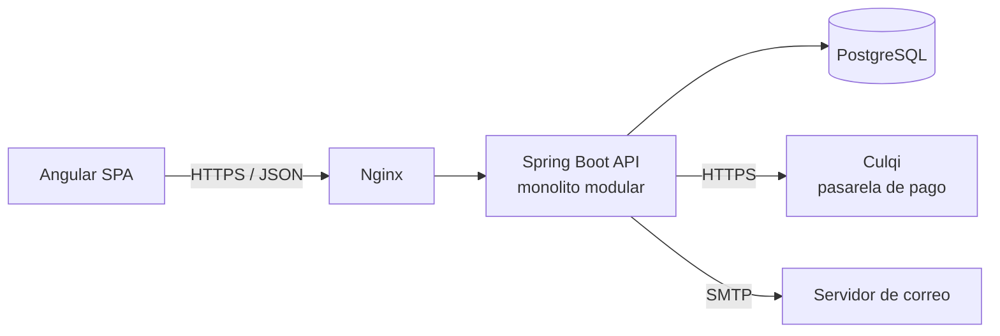

| Pieza | Tecnología |
|---|---|
| Lenguaje y framework | Java 21, Spring Boot 4.1 |
| Persistencia | Spring Data JPA (Hibernate), PostgreSQL 17 |
| Migraciones | Flyway (database first) |
| Seguridad | Spring Security + JWT (access + refresh token) |
| Validación | Jakarta Bean Validation |
| Documentación API | springdoc-openapi (Swagger UI) |
| Infraestructura | Docker Compose, Nginx, VPS (`plutimi.andymallcco.dev`) |

---

## 2. Por qué un monolito modular

Un **monolito modular** es una sola aplicación desplegable, dividida internamente en
módulos con fronteras claras (como si fueran microservicios, pero dentro del mismo
proceso).

| Opción | Ventajas | Inconvenientes para Plutimi |
|---|---|---|
| Monolito "en capas" clásico (`controllers/`, `services/`, `repositories/`) | Simple al empezar | Todo se acopla con todo; para tocar "pedidos" hay que abrir 5 carpetas |
| **Monolito modular** (elegido) | Un despliegue, una base de datos y transacciones locales; código agrupado por funcionalidad; fronteras explícitas | Requiere disciplina para no saltarse las fronteras |
| Microservicios | Escalado y despliegue independientes | Red, consistencia eventual, observabilidad, varios despliegues... complejidad que un equipo de una persona no necesita |

Motivos de la elección:

- **Tamaño del equipo y del dominio**: una persona y un dominio mediano. Los microservicios
  resolverían problemas de organización que no tenemos.
- **Transacciones simples**: crear un pedido y descontar stock ocurre en una única
  transacción de base de datos, sin sagas ni consistencia eventual.
- **Camino de evolución**: si algún módulo necesitara separarse (por ejemplo,
  notificaciones), las fronteras ya existen y la extracción es mecánica.

> **Desde Django:** un proyecto Django con varias *apps* (`catalog`, `orders`...) ya es un
> monolito modular. La diferencia es que aquí cuidamos explícitamente que una app no
> importe los modelos de otra (ver [sección 5](#5-reglas-entre-módulos)).

---

## 3. Estructura de paquetes

Organización **por funcionalidad** (*package by feature*): cada módulo agrupa todo lo
suyo. Lo transversal vive en `shared`.

```
backend/src/main/java/dev/andymallcco/plutimi/
├── PlutimiApplication.java
├── shared/
│   ├── config/          # Configuración transversal: OpenAPI, CORS, JPA auditing, Clock
│   ├── exception/       # GlobalExceptionHandler y excepciones base
│   ├── persistence/     # AuditableEntity (created_at / updated_at)
│   ├── security/        # CurrentUserProvider, AuthenticatedUser (abstracciones)
│   ├── money/           # Money (Value Object)
│   └── web/             # PageResponse y utilidades HTTP
├── auth/                # Registro, login, tokens, configuración de Spring Security
├── user/                # Usuarios, roles y permisos (RBAC)
├── species/             # Especies y razas (datos de referencia compartidos)
├── catalog/             # Categorías, marcas y productos
├── cart/                # Carrito
├── order/               # Pedidos
├── payment/             # Pagos y pasarelas (Strategy)
├── checkout/            # Orquestación de la compra (Facade)
├── pet/                 # Mascotas
├── medicalrecord/       # Historial clínico, catálogo de vacunas y vacunas aplicadas
├── appointment/         # Tipos de cita y citas veterinarias
└── notification/        # Correo, notificaciones y listeners de eventos
```

### Ejemplo completo: módulo `catalog`

```
catalog/
├── Category.java                     # Entidad JPA + reglas de negocio
├── CategoryRepository.java           # Spring Data JPA (package-private)
├── CategoryService.java              # Casos de uso; API pública del módulo
├── CategoryController.java           # /api/v1/categories
├── CategoryMapper.java               # Category <-> DTOs
├── CategoryNotFoundException.java    # extends ResourceNotFoundException
├── Product.java
├── ProductRepository.java            # + JpaSpecificationExecutor<Product>
├── ProductService.java
├── ProductController.java            # /api/v1/products
├── ProductMapper.java
├── ProductSpecifications.java        # Filtros del catálogo (patrón Specification)
├── ProductNotFoundException.java
├── InsufficientStockException.java   # extends BusinessException
└── dto/
    ├── CreateCategoryRequest.java
    ├── UpdateCategoryRequest.java
    ├── CategoryResponse.java
    ├── CreateProductRequest.java
    ├── UpdateProductRequest.java
    ├── ProductResponse.java
    ├── ProductSummaryResponse.java   # Versión reducida para listados
    └── ProductFilter.java            # Parámetros de búsqueda
```

Las excepciones del módulo viven en su raíz y no en una subcarpeta: son pocas y así
se ven junto a la clase que las lanza. Si un módulo crece mucho, se puede dividir en
subpaquetes por agregado (`catalog/product/`, `catalog/category/`).

---

## 4. Capas: responsabilidades y límites

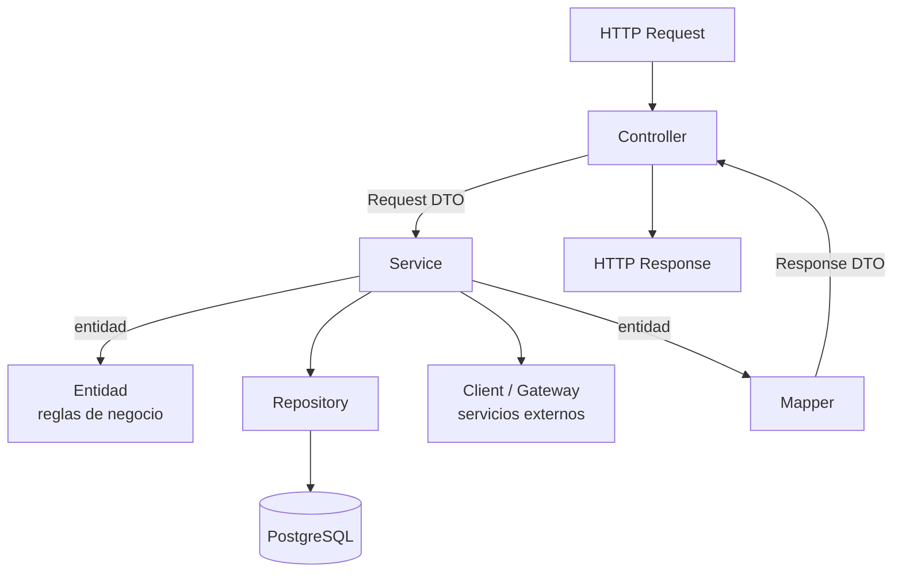

| Capa | Hace | **No** hace |
|---|---|---|
| **Controller** | Mapea HTTP a llamadas al service: rutas, `@Valid`, códigos de estado, cabeceras (`Location`). | Lógica de negocio, `try/catch`, acceso a repositorios, devolver entidades. |
| **DTO** (`record`) | Define el contrato de entrada y salida de la API, con anotaciones de validación en los *requests*. | Lógica. Nunca se persiste. |
| **Mapper** | Convierte entidad ↔ DTO. | Decisiones de negocio ni consultas a la base de datos. |
| **Service** | Orquesta un caso de uso: abre la transacción (`@Transactional`), carga entidades, invoca sus métodos de negocio, persiste, publica eventos y lanza excepciones. | Reglas que pertenecen a una sola entidad (van en la entidad), conocer HTTP (`ResponseEntity`, `HttpServletRequest`) o devolver entidades al controller. |
| **Entidad** | Estado + **reglas de negocio** propias (`order.cancel()`, `product.decreaseStock(n)`). Protege sus invariantes. | Acceder a repositorios, servicios o HTTP. No tiene *setters* públicos para campos con reglas. |
| **Repository** | Acceso a datos con Spring Data JPA: consultas derivadas, `@Query` y Specifications. | Lógica de negocio. Llamadas a servicios externos. |
| **Client / Gateway** | Habla con sistemas externos (Culqi, SMTP) y traduce sus errores a excepciones propias. | Lógica de negocio de Plutimi. |

> **Desde Django:**
> - Controller ≈ *view* (o `APIView`/`ViewSet` de DRF).
> - DTO + validación ≈ *Serializer* de DRF, pero separado en `Request` y `Response`.
> - Service ≈ la capa `services.py` que muchos proyectos Django añaden a mano.
> - Entidad ≈ *Model* con métodos de negocio.
> - Repository ≈ el `Manager`/`QuerySet` (`Product.objects.filter(...)`).
> - Mapper: en DRF lo hace el Serializer; aquí es explícito.

### Modelo rico: la regla vive en la entidad

```java
// Ilustrativo
public class Order {
    public void cancel(Instant now) {
        status.assertCanCancel();        // State: lanza BusinessException si no se puede
        this.status = OrderStatus.CANCELLED;
        this.cancelledAt = now;
    }
}

// El service solo orquesta
@Transactional
public OrderResponse cancel(Long orderId) {
    Order order = findOwnedOrder(orderId);
    order.cancel(clock.instant());
    order.getItems().forEach(item -> productService.restoreStock(item.getProductId(), item.getQuantity()));
    events.publishEvent(new OrderCancelledEvent(order.getId()));
    return orderMapper.toResponse(order);
}
```

**Las entidades nunca salen del service**. El método público del service recibe DTOs o
tipos simples y devuelve DTOs. Así el controller no puede provocar *lazy loading*
accidental y la API no se rompe al cambiar una columna.

Cuando un módulo necesita datos de otro, llama a un método público del service de ese
módulo, que devuelve un DTO o un tipo simple (ver [sección 5](#5-reglas-entre-módulos)).

---

## 5. Reglas entre módulos

Estas reglas mantienen el monolito **modular** y evitan que acabe siendo un monolito
enredado:

1. **Un módulo solo usa a otro a través de su service.** Los repositorios son
   *package-private*, así que el compilador impide que `order` use `ProductRepository`.
2. **Relaciones entre módulos por ID, no por asociación JPA.** Dentro de un módulo sí se
   usan `@ManyToOne`/`@OneToMany`/`@ManyToMany` (por ejemplo `Product → Category`,
   `Order → OrderItem` o `Role ↔ Permission`). Entre módulos se guarda el ID
   (`OrderItem.productId`, `Pet.ownerId`). Una relación N:M con otro módulo se mapea como
   una colección de IDs: `Product.speciesIds` es un `Set<Long>` con `@ElementCollection`
   sobre la tabla `product_species`. La integridad la garantiza igualmente la *foreign key*
   en PostgreSQL.
3. **`shared` no depende de ningún módulo.** Todos los módulos pueden depender de `shared`.
4. **Sin ciclos.** Si dos módulos se necesitan mutuamente, uno de los sentidos se resuelve
   con un **evento** (patrón Observer).
5. **Los efectos secundarios van por eventos.** Por ejemplo, "enviar correo cuando se paga
   un pedido": `order` publica `OrderPaidEvent` y `notification` lo escucha. `order` no
   conoce a `notification`.

Dependencias permitidas (la flecha significa "usa a"):

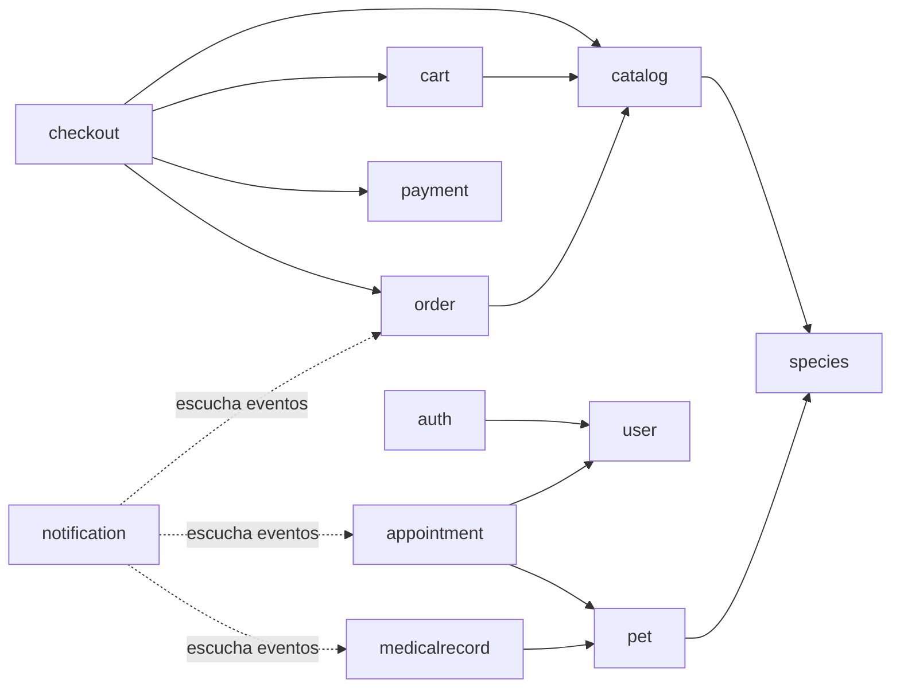

Todos los módulos dependen además de `shared`; no se dibuja para no ensuciar el diagrama.

> Estas reglas se pueden verificar automáticamente con **Spring Modulith** o **ArchUnit**
> (tarea prevista en la fase 4).

---

## 6. Convenciones de nombres

Todo el código va en **inglés**. Los textos que ve el usuario final (mensajes de error y
de validación, correos) van en **español**.

### Clases

| Tipo | Convención | Ejemplo |
|---|---|---|
| Entidad | Sustantivo singular | `Product`, `OrderItem` |
| Value Object | Sustantivo | `Money`, `Address` |
| Repository | `<Entidad>Repository` | `ProductRepository` |
| Service | `<Entidad>Service` | `ProductService` |
| Controller | `<Entidad>Controller` | `ProductController` |
| Mapper | `<Entidad>Mapper` | `ProductMapper` |
| Facade | `<Proceso>Facade` | `CheckoutFacade` |
| Client / Gateway | `<Proveedor><Cosa>Gateway` / `<Cosa>Client` | `CulqiPaymentGateway`, `EmailClient` |
| Excepción | `<Motivo>Exception` | `ProductNotFoundException` |
| Evento | `<Entidad><Pasado>Event` | `OrderPaidEvent` |
| Listener | `<Efecto>Listener` | `OrderEmailListener` |
| Enum de estado | `<Entidad>Status` | `OrderStatus` |

Prohibido: la palabra **`model`** en clases y paquetes, y el sufijo `Impl` por defecto
(solo existen interfaces cuando hay varias implementaciones reales).

### DTOs (siempre `record`)

| Uso | Convención | Ejemplo |
|---|---|---|
| Entrada para crear | `Create<Entidad>Request` | `CreateProductRequest` |
| Entrada para reemplazar (PUT) | `Update<Entidad>Request` | `UpdateProductRequest` |
| Entrada para una acción | `<Acción>Request` | `ChangeOrderStatusRequest`, `LoginRequest` |
| Salida detallada | `<Entidad>Response` | `ProductResponse` |
| Salida para listados | `<Entidad>SummaryResponse` | `ProductSummaryResponse` |
| Filtros de búsqueda | `<Entidad>Filter` | `ProductFilter` |

### Endpoints

- Prefijo `/api/v1`.
- Recursos en **plural** y en *kebab-case*: `/api/v1/products`, `/api/v1/medical-records`.
- Subrecursos para relaciones de pertenencia: `/api/v1/pets/{petId}/vaccinations`.
- Acciones de negocio que no encajan en CRUD van como subrecurso verbal con `POST`:
  `POST /api/v1/orders/{id}/cancel`.
- Excepciones justificadas: `/api/v1/cart` (singular, porque cada usuario tiene un único
  carrito) y `/api/v1/users/me` (el usuario actual).
- Parámetros de consulta en *camelCase*: `?categoryId=3&minPrice=10`.

### Base de datos

| Elemento | Convención | Ejemplo |
|---|---|---|
| Tabla | plural, `snake_case` | `products`, `order_items` |
| Columna | `snake_case` | `created_at`, `price_amount` |
| PK | `id` | `id BIGINT GENERATED ALWAYS AS IDENTITY` |
| Tabla de unión N:M | `<tabla_a>_<tabla_b>` sin `id`, PK compuesta | `role_permissions`, `product_species` |
| PK compuesta | `pk_<tabla>` | `pk_role_permissions` |
| FK | `<entidad>_id` | `category_id` |
| Índice | `idx_<tabla>_<columnas>` | `idx_products_category_id` |
| Único | `uk_<tabla>_<columnas>` | `uk_users_email` |
| FK constraint | `fk_<tabla>_<referencia>` | `fk_products_categories` |
| Check | `ck_<tabla>_<regla>` | `ck_products_stock_non_negative` |
| Exclusión | `ex_<tabla>_<regla>` | `ex_appointments_vet_period` |

### Permisos

`<recurso>:<acción>` en minúsculas y *kebab-case*: `catalog:manage`, `medical-record:write`,
`order:read-all`. El catálogo completo está en [PLAN.md §3](PLAN.md#3-roles-y-permisos).

Hibernate traduce `createdAt` a `created_at` automáticamente (estrategia de nombres por
defecto de Spring Boot), así que normalmente no hace falta `@Column(name = ...)`.

### Migraciones Flyway

`V<n>__<verbo>_<objeto>.sql` en `src/main/resources/db/migration`:

```
V1__create_categories_table.sql
V2__create_species_and_breeds_tables.sql
V3__insert_species_and_breeds.sql
V<n>__add_weight_to_products.sql   # ejemplo de un cambio posterior
```

- **Una migración aplicada nunca se modifica.** Para corregirla se crea una nueva.
- Una migración = un cambio coherente.
- Los datos de referencia van en migraciones `insert_...` separadas de las que crean tablas.
- Los datos de demostración son migraciones **repetibles**: `R__demo_<nn>_<tema>.sql` en
  `db/demo` (ver [sección 7](#datos-iniciales-seeders)).

---

## 7. Base de datos y migraciones

**Database first**: primero se escribe la migración SQL y después la entidad que la
refleja. Hibernate funciona con `ddl-auto=validate`: al arrancar comprueba que las
entidades coinciden con el esquema y, si no coinciden, la aplicación no arranca.

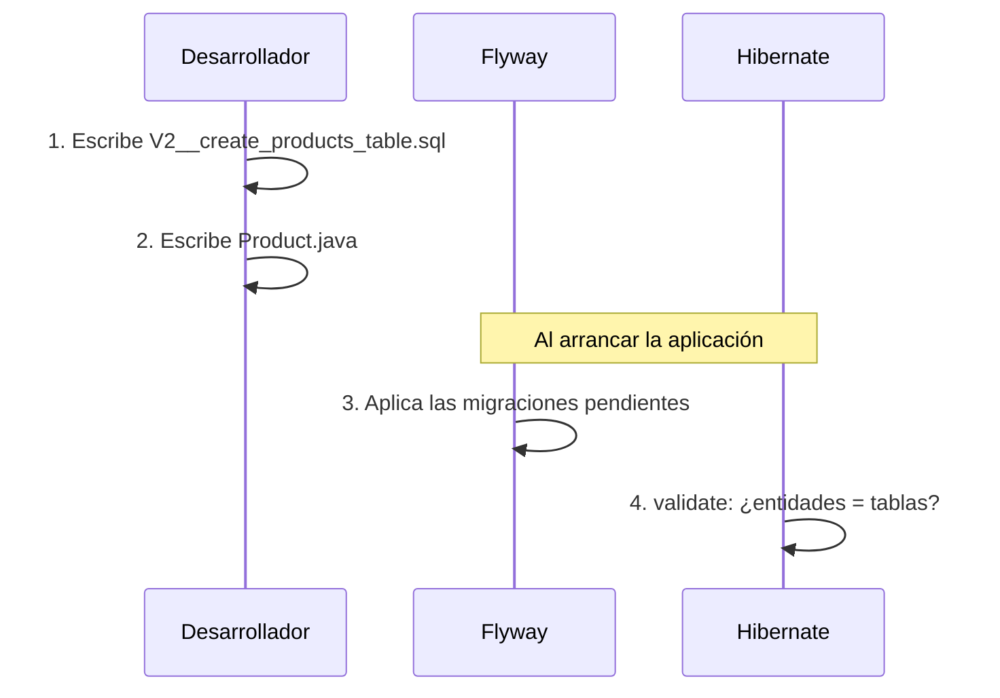

> **Desde Django:** es el camino inverso a `makemigrations`. En Django el modelo genera la
> migración; aquí la migración SQL es la fuente de verdad y la entidad se adapta a ella.
> Ventaja: controlas exactamente el SQL (índices, *constraints*, tipos).

Decisiones de modelado:

| Tema | Decisión | Motivo |
|---|---|---|
| Claves primarias | `BIGINT GENERATED ALWAYS AS IDENTITY` ↔ `Long` + `GenerationType.IDENTITY` | Simple, legible y nativo de PostgreSQL. |
| Fechas y horas | `TIMESTAMPTZ` ↔ `Instant`; `DATE` ↔ `LocalDate` | Siempre en UTC, sin ambigüedad de zona horaria. |
| Dinero | `NUMERIC(12,2)` ↔ `BigDecimal`, envuelto en `Money` | Nunca `double`: los decimales binarios no representan exactamente 0.10. |
| Moneda | Columna `CHAR(3)` (ISO 4217); por ahora siempre `PEN` | El Value Object queda completo y no habrá que migrar si se añade otra moneda. |
| Enums | `VARCHAR` + `CHECK` ↔ `@Enumerated(EnumType.STRING)` | Legibles en la base de datos; reordenar el enum no corrompe datos (`ORDINAL` sí). |
| Auditoría | `created_at` / `updated_at` mediante `AuditableEntity` (`@MappedSuperclass`) y JPA Auditing. En SQL: `TIMESTAMPTZ NOT NULL DEFAULT now()` | Evita repetir esos campos en cada entidad. El `DEFAULT` cubre los `INSERT` que no pasan por JPA (seeders). |
| Concurrencia | `@Version` (columna `version`) en `Product`, `Order` y `Appointment`; restricción de exclusión en `appointments` | Bloqueo optimista: dos compras simultáneas del último producto no pueden dejar el stock negativo. La exclusión impide citas solapadas (ver más abajo). |
| Borrado | *Soft delete* (`active = false`) para categorías, productos y mascotas | Los pedidos e historiales los referencian; borrarlos físicamente rompería el histórico. |
| Snapshot | `order_items` copia el nombre y el precio unitario del producto; `appointments.ends_at` copia la duración del tipo de cita | El pasado no debe cambiar si cambia el catálogo o la configuración. |
| Integridad compleja | FK compuesta (raza ↔ especie) y restricción de exclusión (citas solapadas) | Lo que la base de datos puede garantizar no se deja solo al código: resiste concurrencia y errores de programación. |

### Enum o tabla de referencia

| Usar un **enum** (`VARCHAR` + `CHECK` ↔ `@Enumerated(STRING)`) cuando... | Usar una **tabla de referencia** cuando... |
|---|---|
| Cada valor implica **comportamiento en el código** (transiciones, una Strategy) | Los valores son **datos**: el código no tiene un `if` por cada uno |
| Añadir un valor exige desplegar código nuevo de todas formas | Un admin podría querer añadir valores sin desplegar |
| `OrderStatus`, `AppointmentStatus`, `PaymentProvider`, `PetSex` | Roles, permisos, especies, razas, marcas, vacunas, tipos de cita |

Las tablas de referencia con un `code` estable (`species.code = 'DOG'`, `roles.code = 'ADMIN'`)
permiten que el código o los seeders se refieran a una fila concreta sin depender de su
`id`, que puede variar entre entornos.

### FK compuesta: la raza pertenece a la especie

`pets` guarda `species_id` y `breed_id`. Para que la base de datos impida un gato de raza
"Labrador":

```sql
-- breeds
CONSTRAINT uk_breeds_id_species UNIQUE (id, species_id)
-- pets
CONSTRAINT fk_pets_breeds FOREIGN KEY (breed_id, species_id) REFERENCES breeds (id, species_id)
```

La FK exige que exista una raza con **ese id y esa especie a la vez**. Con `breed_id NULL`
la FK no se evalúa, así que la raza sigue siendo opcional. El service valida lo mismo antes
para devolver un mensaje claro; la FK es la red de seguridad.

### Citas: grilla de turnos y doble reserva

**Grilla fija.** La agenda se divide en turnos base de 30 minutos (configurable con
`plutimi.appointments.slot-minutes`). Cada tipo de cita dura un múltiplo del turno base:
una consulta ocupa 1 turno y un baño y corte de 60 minutos ocupa 2 turnos consecutivos.
Las citas empiezan siempre en el borde de un turno.

Reglas en la base de datos:

```sql
-- appointment_types
CONSTRAINT ck_appointment_types_duration CHECK (duration_minutes > 0 AND duration_minutes % 30 = 0)
-- appointments
CONSTRAINT ck_appointments_aligned CHECK (
    EXTRACT(EPOCH FROM scheduled_at)::BIGINT % 1800 = 0 AND
    EXTRACT(EPOCH FROM ends_at)::BIGINT % 1800 = 0 AND
    ends_at > scheduled_at)
```

El `30` de la base de datos y el `slot-minutes` de la aplicación deben coincidir. Por eso
la aplicación comprueba **al arrancar** que todos los tipos activos son múltiplos del turno
configurado y, si no, no arranca (*fail fast*). Cambiar el turno base implica cambiar la
propiedad **y** escribir una migración que actualice los `CHECK`.

**Cálculo de disponibilidad** (`GET /appointments/availability?vetId&date&appointmentTypeId`):

1. Se genera la grilla del día con el horario de atención: 09:00, 09:30, 10:00...
2. Se marcan como ocupados los turnos cubiertos por citas activas (`REQUESTED` o
   `CONFIRMED`) del veterinario: una cita de 10:00 a 11:00 ocupa los turnos de 10:00 y 10:30.
3. Para un tipo que necesita `k = duración / turno base` turnos, una hora de inicio es
   válida si los `k` turnos consecutivos están libres y dentro del horario de atención.
4. Se devuelven esas horas de inicio, excluyendo las que ya pasaron.

```
Turnos:     09:00  09:30  10:00  10:30  11:00  11:30
Ocupado:      -      -     [ cita 60' ]    -      -
Tipo 30':   09:00  09:30                11:00  11:30   → 4 inicios posibles
Tipo 60':   09:00                       11:00          → 09:30 no (pisaría 10:00)
```

**Protección contra doble reserva.** Con duraciones distintas, un índice único sobre
`(vet_id, scheduled_at)` ya no basta: una cita de 60' a las 10:00 y otra de 30' a las 10:30
empiezan a horas distintas pero se solapan. Se usa una **restricción de exclusión** de
PostgreSQL (necesita la extensión `btree_gist`):

```sql
CONSTRAINT ex_appointments_vet_period EXCLUDE USING gist (
    vet_id WITH =,
    tstzrange(scheduled_at, ends_at) WITH &&
) WHERE (status IN ('REQUESTED', 'CONFIRMED'))
```

- Significa que no puede haber dos filas con el mismo `vet_id` y rangos solapados (`&&`),
  contando solo las citas activas: cancelar libera el horario.
- El rango `[inicio, fin)` es semiabierto, así que las citas **contiguas** (10:00–11:00 y
  11:00–11:30) están permitidas.
- **Carrera:** si dos clientes ven libre el mismo horario y reservan a la vez, ambos pasan la
  validación del service, pero PostgreSQL rechaza el segundo `INSERT` (SQLState `23P01`,
  `exclusion_violation`). El service lo traduce a `SlotUnavailableException` (409). La
  disponibilidad que muestra la API es orientativa; la garantía la da la base de datos.

### Datos iniciales (seeders)

| Nivel | Qué | Cómo | Dónde se ejecuta |
|---|---|---|---|
| **Referencia** | Roles, permisos, especies, razas, vacunas, tipos de cita | Migraciones versionadas `V<n>__insert_...sql` en `db/migration` | Todos los entornos |
| **Demostración** | Usuarios de prueba de cada rol, marcas, categorías, productos y mascotas | Migraciones repetibles `R__demo_<nn>_<tema>.sql` en `db/demo` | Solo `dev` |
| **Admin de producción** | Primer usuario `ADMIN` | `AdminInitializer` (`ApplicationRunner`) con `ADMIN_EMAIL` y `ADMIN_PASSWORD` | Si no existe ningún admin |

- **Referencia**: el código depende de estos datos (por ejemplo, el registro busca el rol
  `CUSTOMER`), así que deben existir en todos los entornos, versionados con el esquema.
- **Demostración**: `application-dev.properties` añade la ubicación con
  `spring.flyway.locations=classpath:db/migration,classpath:db/demo`. En `prod` y `test`
  esa carpeta no se lee.
- **Por qué repetibles (`R__`) y no versionadas:** Flyway ejecuta las repetibles después
  de todas las versionadas y las vuelve a ejecutar cuando cambia su contenido. Si fueran
  versionadas con números altos (por ejemplo `V1000__demo`), al añadir después `V10__...`
  Flyway detectaría una migración nueva con número menor que una ya aplicada y fallaría la
  validación.
- **Idempotencia:** como pueden ejecutarse varias veces, usan
  `INSERT ... ON CONFLICT (<clave natural>) DO NOTHING` (por `email`, `sku`, `slug`...) y
  buscan las FK por código (`SELECT id FROM roles WHERE code = 'VET'`), nunca por `id` fijo.
- Los tests usan el perfil `test`, sin datos demo: cada test prepara sus propios datos.

> **Desde Django:** los datos de referencia equivalen a una *data migration* (`RunPython`),
> y los de demostración a un `loaddata demo.json` que solo ejecutas en local.

---

## 8. Diseño de la API REST

### Versionado: por qué `/api/v1`

Un frontend (o una app móvil futura) depende del **contrato** de la API. Si un día
cambiamos de forma incompatible un recurso (renombrar un campo, cambiar la paginación),
romperíamos a los clientes ya desplegados. Con la versión en la URL:

- Los cambios **compatibles** (añadir un campo o un endpoint) se hacen en `v1` sin más.
- Un cambio **incompatible** se publica en `/api/v2` y `v1` convive hasta que los clientes
  migran.
- Es explícito, fácil de enrutar en Nginx y de documentar en Swagger.

Se eligió la versión en la URL frente a la versión en una cabecera (`Accept: application/vnd...`)
porque es más fácil de probar desde el navegador o con `curl` y más didáctica.

### Códigos de estado

| Situación | Código |
|---|---|
| Lectura correcta | `200 OK` |
| Creación | `201 Created` + cabecera `Location` |
| Borrado o acción sin cuerpo | `204 No Content` |
| Validación fallida, JSON mal formado | `400 Bad Request` |
| Sin autenticar o token inválido | `401 Unauthorized` |
| Autenticado pero sin permiso | `403 Forbidden` |
| Recurso inexistente o ajeno | `404 Not Found` |
| Conflicto (email duplicado, edición concurrente) | `409 Conflict` |
| Regla de negocio violada (stock insuficiente, no se puede cancelar) | `422 Unprocessable Content` |
| Error inesperado | `500 Internal Server Error` |

Si un cliente pide un pedido **de otro usuario**, se devuelve `404`, no `403`, para no
revelar que ese ID existe.

### Validación

Los *request records* llevan anotaciones de Bean Validation y el controller los recibe con
`@Valid`:

```java
// Ilustrativo
public record CreateProductRequest(
        @NotBlank(message = "El nombre es obligatorio") @Size(max = 150) String name,
        @NotNull @DecimalMin(value = "0.00", inclusive = false) BigDecimal price,
        @NotNull @PositiveOrZero Integer stock,
        @NotNull Long categoryId) {}
```

Bean Validation valida **la forma** del dato (obligatorio, rango, formato). Las reglas que
dependen del estado del sistema (¿existe la categoría?, ¿hay stock?) las comprueban el
service y la entidad.

### Paginación

Todos los listados aceptan `?page=0&size=20&sort=name,asc` (el `Pageable` de Spring Data)
y responden con un `PageResponse<T>` propio:

```json
{
  "content": [ { "id": 1, "name": "Croquetas adulto 3kg" } ],
  "page": 0,
  "size": 20,
  "totalElements": 134,
  "totalPages": 7
}
```

Se usa un `record` propio en vez de serializar el `Page` de Spring, cuyo JSON es interno y
puede cambiar entre versiones. Así el contrato es estable. El `size` máximo es 100.

### Documentación

springdoc-openapi genera la especificación OpenAPI a partir de los controllers y los DTOs.
Swagger UI queda disponible en `/swagger-ui.html` (solo en el perfil `dev`).

---

## 9. Manejo de errores

### Principios

- Los **services y las entidades lanzan excepciones**. Los controllers no usan `try/catch`.
- Un único `GlobalExceptionHandler` (`@RestControllerAdvice`) traduce las excepciones a HTTP.
- Todas las respuestas de error usan **`ProblemDetail`** (estándar RFC 9457,
  `Content-Type: application/problem+json`).
- Los errores 500 **no exponen detalles internos** (ni *stack traces* ni SQL), pero se
  registran completos en el log.

### Jerarquía de excepciones

```
RuntimeException
└── ApplicationException (abstracta, shared/exception)
    ├── ResourceNotFoundException   → 404
    │   ├── ProductNotFoundException
    │   └── OrderNotFoundException ...
    ├── ConflictException           → 409
    │   └── EmailAlreadyRegisteredException ...
    └── BusinessException           → 422
        ├── InsufficientStockException
        └── InvalidOrderStateException ...
```

Las excepciones de cada módulo heredan de una base, así que el handler no necesita conocer
cada excepción concreta: le basta con las tres bases.

Además, el handler traduce excepciones del framework:

| Excepción | Código |
|---|---|
| `MethodArgumentNotValidException` (`@Valid` en el *body*) | 400 + lista de campos |
| `HandlerMethodValidationException` (parámetros de la URL) | 400 |
| `HttpMessageNotReadableException` (JSON mal formado) | 400 |
| `AuthenticationException` / `AccessDeniedException` | 401 / 403, resueltos en la configuración de seguridad |
| `ObjectOptimisticLockingFailureException` | 409 ("otro usuario modificó el recurso") |
| `DataIntegrityViolationException` | 409 (última red de seguridad para *constraints* `UNIQUE`) |
| `Exception` (cualquier otra) | 500 genérico + `log.error` con la traza |

### Flujo de una excepción

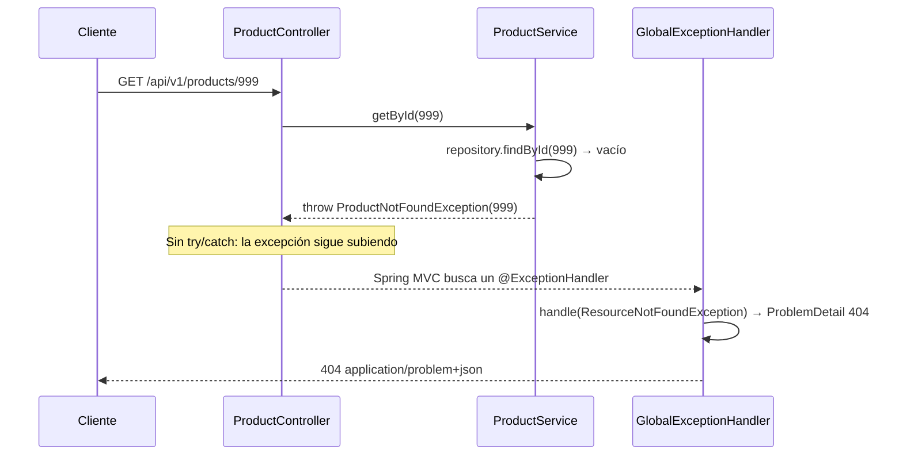

Respuesta:

```json
{
  "type": "https://plutimi.andymallcco.dev/problems/resource-not-found",
  "title": "Recurso no encontrado",
  "status": 404,
  "detail": "No existe un producto con id 999",
  "instance": "/api/v1/products/999",
  "timestamp": "2026-10-28T19:12:24Z"
}
```

Error de validación (400) con los campos que fallaron:

```json
{
  "type": "https://plutimi.andymallcco.dev/problems/validation-error",
  "title": "Datos inválidos",
  "status": 400,
  "detail": "La petición contiene 2 errores de validación",
  "instance": "/api/v1/products",
  "timestamp": "2026-10-28T19:15:02Z",
  "errors": [
    { "field": "name",  "message": "El nombre es obligatorio" },
    { "field": "price", "message": "debe ser mayor que 0.00" }
  ]
}
```

Error inesperado (500), sin detalles internos:

```json
{
  "type": "about:blank",
  "title": "Error interno",
  "status": 500,
  "detail": "Ocurrió un error inesperado. Inténtalo de nuevo más tarde.",
  "instance": "/api/v1/checkout",
  "timestamp": "2026-10-28T19:20:41Z"
}
```

> **Desde Django:** `@RestControllerAdvice` cumple el papel del `EXCEPTION_HANDLER` de DRF:
> un punto central que convierte excepciones en respuestas. `ResourceNotFoundException`
> equivale a `Http404` / `NotFound`.

---

## 10. Autenticación y autorización

### Dos preguntas distintas

Es fácil mezclarlas, pero son independientes:

| Pregunta | Concepto | Opciones | En Plutimi |
|---|---|---|---|
| **¿Quién eres?** (demostrarlo una vez) | **Credenciales / proveedor de identidad** | Email y contraseña, Google (OAuth2/OIDC), *magic link*... | Email + contraseña (BCrypt). Google en el futuro. |
| **¿Cómo te recuerdo en las siguientes peticiones?** | **Mecanismo de sesión** | Cookie de sesión (estado en el servidor) o token (JWT) | JWT: *access token* corto + *refresh token* |

Por eso añadir "login con Google" **no debería cambiar la sesión**: Google solo sustituye
el primer paso (demostrar la identidad). Después emitimos nuestros propios tokens igual
que tras un login con contraseña.

### Cookie de sesión vs JWT

| | Cookie de sesión (Django por defecto) | JWT |
|---|---|---|
| Dónde está el estado | En el servidor (tabla o caché de sesiones) | En el propio token, firmado |
| Cada petición | Busca la sesión en el almacén | Verifica la firma criptográfica, sin consultar la base de datos |
| Revocación | Inmediata (se borra la sesión) | Difícil: el token es válido hasta que expira |
| Clientes | Ideal para web del mismo dominio | Cómodo para SPA, apps móviles y otros dominios |
| Riesgo típico | CSRF | Robo del token (XSS) si se guarda mal |

### Por qué JWT con refresh token

El inconveniente principal del JWT (no se puede revocar) se compensa con dos tokens:

- **Access token** (JWT, **15 min**): viaja en `Authorization: Bearer ...` en cada petición.
  Si lo roban, sirve muy poco tiempo. Angular lo guarda **en memoria**, no en `localStorage`.
- **Refresh token** (opaco y aleatorio, **7 días**): solo sirve para pedir un nuevo access
  token en `POST /api/v1/auth/refresh`. Se guarda **hasheado** en la tabla `refresh_tokens`,
  así que sí se puede revocar (logout, cambio de contraseña). Viaja en una **cookie
  `HttpOnly`, `Secure`, `SameSite=Strict`** restringida a la ruta `/api/v1/auth`:
  JavaScript no puede leerlo, lo que mitiga el robo por XSS.
- **Rotación**: cada refresh invalida el token usado y emite uno nuevo. Si llega un refresh
  token ya usado (posible robo), se revocan todos los del usuario.

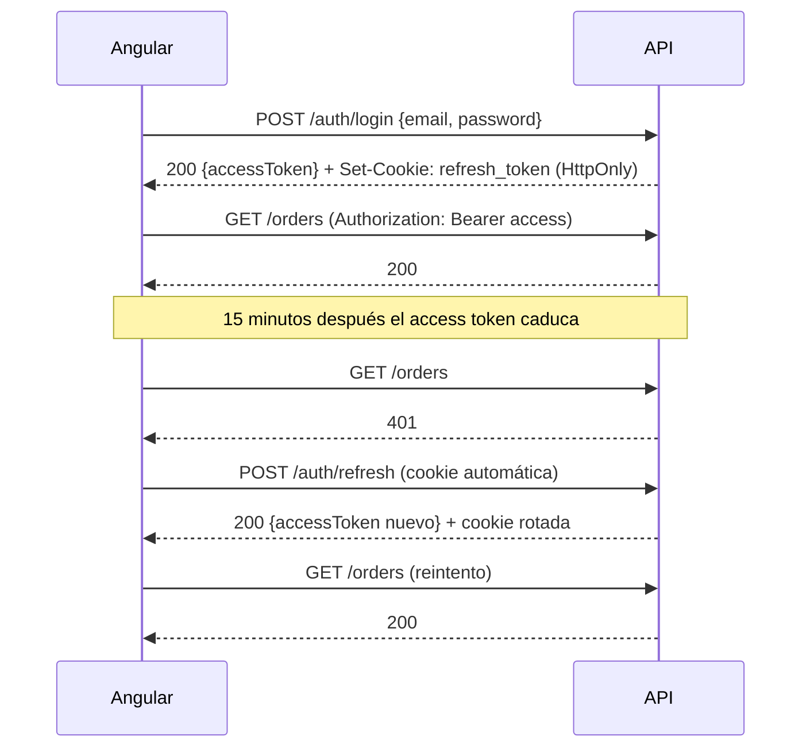

Detalles técnicos:

- Los JWT se firman con HMAC-SHA256 usando el **soporte nativo de Spring Security**
  (`spring-boot-starter-oauth2-resource-server`, con `JwtEncoder` y `JwtDecoder` de
  Nimbus). No hace falta una librería externa como `jjwt`, y Spring Security valida
  firma, expiración y *claims* automáticamente.
- Las contraseñas se guardan con **BCrypt** (`PasswordEncoder`).
- *Claims* del access token: `sub` (id del usuario), `email`, `role` (código del rol),
  `permissions` (lista de códigos de permiso), `iat` y `exp`.

### Aislamiento: cómo se puede cambiar sin tocar el resto

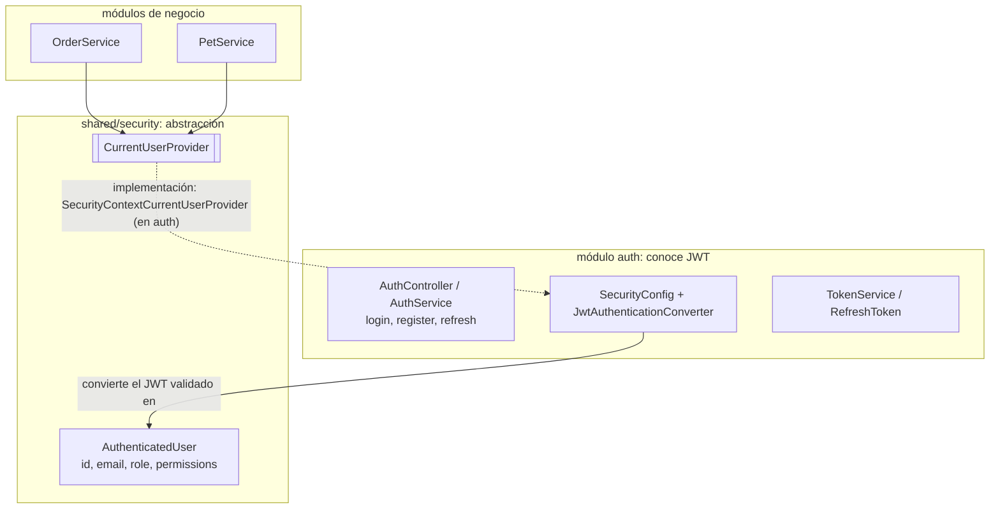

1. El módulo `auth` es el **único** que sabe que existe JWT.
2. Tras validar el token, `auth` coloca en el `SecurityContext` de Spring un principal
   propio, `AuthenticatedUser(id, email, role, permissions)`, que es independiente del
   mecanismo.
3. Los demás módulos solo conocen la interfaz `CurrentUserProvider` (en `shared/security`),
   con métodos como `currentUser()`, `currentUserId()` y `hasPermission(code)`.
4. Para añadir **Google**, el login OAuth2 también terminará produciendo un
   `AuthenticatedUser` (y emitiendo los mismos tokens). `OrderService` y `PetService` no
   cambian.
5. En los tests, `CurrentUserProvider` se sustituye por un *fake* sin levantar seguridad.

Esta interfaz es una **excepción consciente** a la regla "interfaces solo con varias
implementaciones": es una frontera de arquitectura (un *puerto*) y además tiene una segunda
implementación real en los tests.

### Autorización: RBAC con permisos

**RBAC** (*Role-Based Access Control*) normalizado en la base de datos:

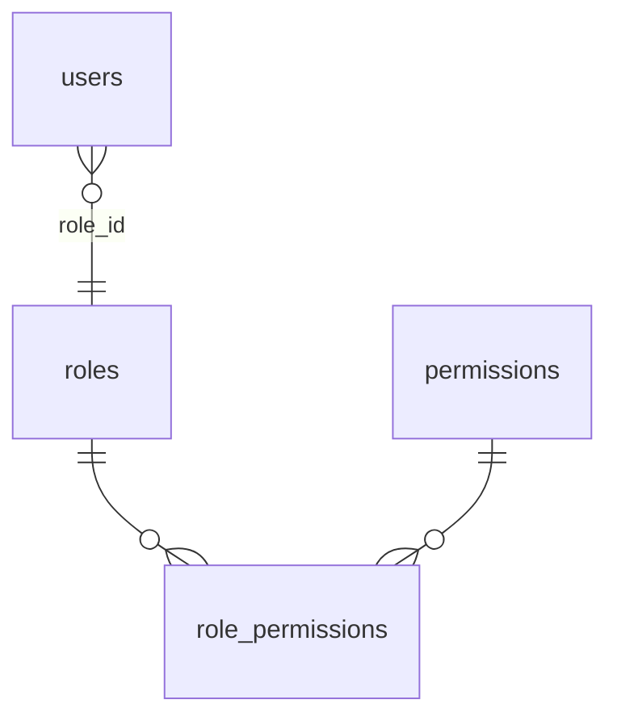

- Cada usuario tiene **un rol** (`users.role_id`). Cada rol agrupa **N permisos**
  (`role_permissions`, N:M con PK compuesta).
- Roles base: `CUSTOMER` (asignado al registrarse), `VET` y `ADMIN`, marcados como `system`.
  El admin puede crear roles nuevos con cualquier combinación de permisos.
- El rol `ADMIN` nunca pierde `role:manage` ni `user:manage` (409 si se intenta quitárselos):
  así siempre hay alguien capaz de gestionar roles y usuarios.
- Los permisos son de solo lectura en la API: se crean con migraciones porque cada uno
  tiene sentido solo si hay código que lo comprueba.
- Catálogo de permisos y asignación por rol: [PLAN.md §3](PLAN.md#3-roles-y-permisos).

**Los endpoints comprueban permisos, no roles:**

```java
// Ilustrativo
@PreAuthorize("hasAuthority('catalog:manage')")
@PostMapping
public ResponseEntity<ProductResponse> create(@Valid @RequestBody CreateProductRequest request) { ... }
```

¿Por qué permisos y no `hasRole('ADMIN')`?

- **El código pregunta "¿puede hacer X?" y no "¿quién es?".** Para crear un rol
  `STOCK_MANAGER` que solo gestione el catálogo basta con asignarle `catalog:manage` desde
  la API. Con `hasRole('ADMIN')` habría que cambiar el código y desplegar.
- Las reglas quedan documentadas en un solo lugar: la tabla de asignación.
- Solo hay dos referencias a códigos de rol en el código: el registro (`CUSTOMER`) y el
  listado de veterinarios (`VET`).

**Propiedad y permisos `*:read-all`.** Que un cliente vea *sus* pedidos no es un permiso,
es una regla de propiedad que aplica el service. Los permisos `*:read-all` amplían ese
alcance:

```java
// Ilustrativo
public PageResponse<OrderSummaryResponse> list(OrderFilter filter, Pageable pageable) {
    AuthenticatedUser user = currentUserProvider.currentUser();
    if (!user.hasPermission("order:read-all")) {
        filter = filter.withUserId(user.id());   // solo los suyos
    }
    ...
}
```

### Cómo Spring Security convierte rol y permisos en *authorities*

**Concepto Spring:** para Spring Security, todo lo que un usuario "tiene" es una
**`GrantedAuthority`**, un objeto que envuelve un simple `String`. Spring no distingue
entre roles y permisos; la diferencia es solo una convención:

| Expresión | Qué comprueba |
|---|---|
| `hasAuthority('catalog:manage')` | Que exista la authority con ese texto exacto |
| `hasRole('ADMIN')` | Que exista la authority `"ROLE_ADMIN"` (añade el prefijo `ROLE_` por ti) |

El recorrido completo:

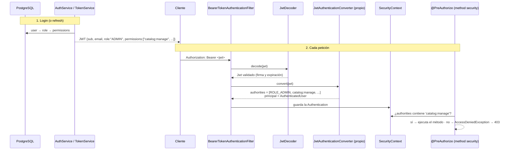

1. **Al hacer login** (y en cada refresh), `AuthService` carga el usuario con su rol y los
   permisos del rol. `TokenService` los escribe en el JWT como *claims* `role` y
   `permissions`.
2. **En cada petición**, el filtro `BearerTokenAuthenticationFilter` (de OAuth2 Resource
   Server) extrae el token de la cabecera, y el `JwtDecoder` comprueba la firma y la
   expiración.
3. Un **`JwtAuthenticationConverter` propio** transforma el `Jwt` en una `Authentication`:
   - el *claim* `role` → `SimpleGrantedAuthority("ROLE_ADMIN")`;
   - cada elemento de `permissions` → `SimpleGrantedAuthority("catalog:manage")`, sin prefijo;
   - el principal pasa a ser nuestro `AuthenticatedUser`.

   El conversor que Spring trae por defecto leería el *claim* `scope` y añadiría el prefijo
   `SCOPE_`, por eso lo sustituimos.
4. La `Authentication` se guarda en el `SecurityContext`, que dura lo que dura la petición.
5. `@PreAuthorize` funciona porque Spring envuelve el controller en un **proxy** (AOP) que,
   antes de llamar al método, evalúa la expresión contra las authorities del
   `SecurityContext`. Si falla, lanza `AccessDeniedException`, que se convierte en un 403.

**Por qué los permisos viajan en el token:** así ninguna petición consulta la base de datos
para autorizar, que es la ventaja de usar JWT. El coste es que un cambio de permisos tarda
en aplicarse lo que queda de vida al access token (como máximo 15 minutos): el siguiente
refresh vuelve a leer los permisos de la base de datos. Cuando se cambia el rol de un
usuario o se le desactiva, además se revocan sus refresh tokens, así que pierde el acceso en
cuanto caduca su access token.

**Otras piezas:**

- `SecurityConfig` define lo público (GET del catálogo, especies, `/auth/**`, Swagger en
  dev) y exige autenticación para el resto.
- `@PreAuthorize` habla de **permisos**, no de JWT, así que no rompe el aislamiento de `auth`.

> **Desde Django:** este modelo es casi idéntico al de `django.contrib.auth`: `Permission`
> ≈ nuestros permisos (`app.add_product`), `Group` ≈ nuestros roles, y
> `user.has_perm('catalog.manage')` ≈ `hasAuthority('catalog:manage')`. La diferencia es
> que aquí cada usuario tiene un solo rol. `CurrentUserProvider` ≈ `request.user`, pero
> inyectado como dependencia, y `@PreAuthorize` ≈ las *permission classes* de DRF.

---

## 11. Pagos

- **Proveedor**: Culqi en modo prueba (pasarela peruana, coherente con la moneda PEN).
- **Los datos de la tarjeta nunca tocan nuestro backend.** Angular usa el checkout de Culqi
  para *tokenizar* la tarjeta y envía solo el token (`tkn_test_...`) a la API. Así el
  servidor queda fuera del alcance de PCI DSS.
- El backend crea el cargo con la clave secreta llamando a la API de Culqi desde
  `CulqiPaymentGateway`.
- Cada intento se guarda en la tabla `payments` (proveedor, id del cargo, estado y motivo
  del fallo).

### Transacciones y llamadas externas

Una llamada HTTP a Culqi **no debe ocurrir dentro de una transacción de base de datos**:
mantendría bloqueos y conexiones abiertas mientras esperamos a la red. Por eso el checkout
se divide en pasos:

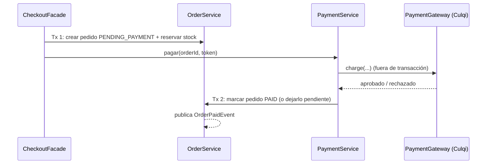

Si el pago se rechaza, el pedido queda en `PENDING_PAYMENT` y se puede reintentar con
`POST /api/v1/orders/{id}/payments`. Un pedido pendiente que no se paga en 30 minutos se
cancela automáticamente (tarea `@Scheduled`) y se libera el stock.

---

## 12. Patrones de diseño

Solo donde resuelven un problema real:

| Patrón | Dónde | Problema que resuelve |
|---|---|---|
| **Strategy** | `payment`: interfaz `PaymentGateway` con `CulqiPaymentGateway` y `FakePaymentGateway` | Cambiar de proveedor o añadir otro (Mercado Pago) sin tocar el checkout. El *fake* permite desarrollar y testear sin red. Un `PaymentGatewayResolver` elige la estrategia según `PaymentProvider`. |
| **State** | `order` (`OrderStatus`) y `appointment` (`AppointmentStatus`) | Evitar `if/switch` dispersos sobre "¿puedo pasar de X a Y?". Cada estado sabe a qué estados puede transicionar y qué acciones permite. |
| **Observer** | Eventos de Spring (`ApplicationEventPublisher` + `@TransactionalEventListener`) | Desacoplar efectos secundarios (correos, notificaciones, recordatorios) del caso de uso principal. |
| **Specification** | `catalog`: `ProductSpecifications` + `JpaSpecificationExecutor` | Combinar filtros opcionales del catálogo (categoría, rango de precio, texto, marca, stock) sin escribir un método de repositorio por cada combinación. |
| **Facade** | `checkout`: `CheckoutFacade` | Ofrecer una sola operación ("comprar") que coordina carrito, catálogo, pedido y pago, y ocultar esa complejidad al controller. |
| **Value Object** | `Money`, `Address` (`@Embeddable`) | Encapsular reglas de un valor (no sumar monedas distintas, redondeo a 2 decimales) y darle nombre de dominio. |

### State con enum

Con JPA el estado debe persistirse en una columna, así que el patrón State se implementa
con un **enum con comportamiento** en lugar de una clase por estado:

```java
// Ilustrativo
public enum OrderStatus {
    PENDING_PAYMENT { Set<OrderStatus> next() { return Set.of(PAID, CANCELLED); } },
    PAID            { Set<OrderStatus> next() { return Set.of(SHIPPED, CANCELLED); } },
    SHIPPED         { Set<OrderStatus> next() { return Set.of(DELIVERED); } },
    DELIVERED       { Set<OrderStatus> next() { return Set.of(); } },
    CANCELLED       { Set<OrderStatus> next() { return Set.of(); } };

    abstract Set<OrderStatus> next();

    void assertCanTransitionTo(OrderStatus target) {
        if (!next().contains(target)) throw new InvalidOrderStateException(this, target);
    }
}
```

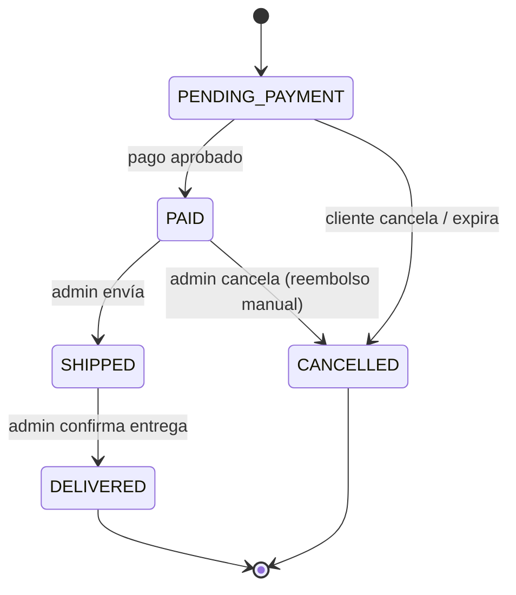

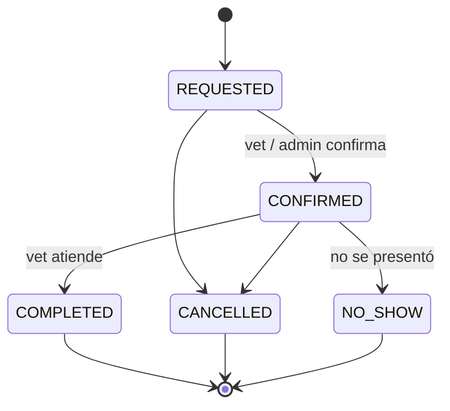

### Observer con eventos de Spring

- Los eventos son `record` inmutables con IDs, no entidades: `OrderPaidEvent(Long orderId)`.
- Se usa `@TransactionalEventListener(phase = AFTER_COMMIT)`: el correo de "pedido pagado"
  solo se envía si la transacción se confirmó. Si hubo *rollback*, no se envía.
- Los listeners lentos (correo) se ejecutan con `@Async` para no retrasar la respuesta HTTP.

> **Desde Django:** es el equivalente a los *signals* (`post_save`), pero con eventos
> explícitos de dominio y con la garantía de ejecutarse después del *commit* (como
> `transaction.on_commit`).

---

## 13. Configuración y perfiles

```
src/main/resources/
├── application.properties        # Común: JPA, Flyway, Jackson, paginación
├── application-dev.properties    # Local: BD en localhost:5434, logs SQL, Swagger, datos demo
├── application-prod.properties   # VPS: todo por variables de entorno, sin valores por defecto
└── db/
    ├── migration/                # Esquema + datos de referencia (todos los entornos)
    └── demo/                     # Datos de demostración R__demo_*.sql (solo dev)
```

- Los tests se ejecutan con el perfil `test` (`@ActiveProfiles("test")`): PostgreSQL propio
  con Testcontainers y sin datos demo.

- `spring.profiles.default=dev`: al ejecutar desde IntelliJ se usa `dev` sin configurar nada.
  En producción se arranca con `SPRING_PROFILES_ACTIVE=prod`.
- **Secretos siempre en variables de entorno**: `DB_PASSWORD`, `JWT_SECRET`,
  `CULQI_SECRET_KEY`, `MAIL_PASSWORD`...
- En `prod`, las variables **no tienen valor por defecto**: si falta una, la aplicación no
  arranca (*fail fast*), en lugar de arrancar con una contraseña de desarrollo.
- Las propiedades propias (`plutimi.jwt.access-token-ttl`, `plutimi.payment.culqi.*`) se
  agrupan en clases `@ConfigurationProperties` tipadas como `record`, en lugar de usar
  `@Value` disperso.

> **Desde Django:** los perfiles equivalen a tener `settings/dev.py` y `settings/prod.py`.
> `@ConfigurationProperties` es como leer `settings.JWT_CONFIG` pero con tipos y validación
> al arrancar.

---

## 14. Principios de código

- **Inyección por constructor** siempre, con campos `private final`. Nunca `@Autowired` en
  atributos. Con Lombok: `@RequiredArgsConstructor`.
  > **Concepto Spring:** el contenedor de Spring crea los objetos (*beans*) y les pasa sus
  > dependencias por el constructor. Es lo que en Django harías a mano importando módulos;
  > aquí permite sustituir dependencias en los tests.
- **Interfaces solo con varias implementaciones reales** (`PaymentGateway`) o en una
  frontera de arquitectura (`CurrentUserProvider`). Nada de `ProductService` +
  `ProductServiceImpl` por costumbre.
- **Lombok en entidades**: `@Getter`, `@Setter` solo en campos sin reglas,
  `@NoArgsConstructor(access = PROTECTED)` (lo exige JPA) y constructores o métodos de
  fábrica explícitos. **Nunca `@Data`** (genera `equals`/`hashCode`/`toString` sobre todos
  los campos, rompe con proxies y relaciones *lazy* y puede provocar bucles infinitos).
- `equals`/`hashCode` de las entidades basados en el `id` (con `getClass()` consciente
  de los proxies), o no se sobrescriben.
- **Mappers manuales** (`@Component` con métodos `toResponse`, `toEntity`): explícitos y
  fáciles de depurar mientras se aprende. MapStruct queda como mejora opcional.
- `@Transactional` en los métodos públicos del service; `@Transactional(readOnly = true)`
  en las lecturas.
- `Clock` inyectado en lugar de `Instant.now()` para que el tiempo sea testeable.
- SOLID con criterio: la meta es código fácil de cambiar, no aplicar patrones por aplicarlos.

---

## 15. Glosario

| Término | Qué es | En Plutimi |
|---|---|---|
| **Entidad JPA** | Clase anotada con `@Entity` que Hibernate mapea a una tabla. Es un concepto **técnico de persistencia**: tiene `@Id` y su ciclo de vida lo gestiona el `EntityManager`. | `Product`, `Order`... |
| **Entidad (DDD)** | Concepto de **dominio**: un objeto con **identidad propia** que perdura aunque cambien sus atributos. Dos pedidos con los mismos datos siguen siendo pedidos distintos. | El pedido #42 es el mismo aunque cambie su estado. |
| **Modelo de dominio** | El conjunto de clases que representan los conceptos y reglas del negocio (entidades DDD, Value Objects, enums de estado). Puede ser **rico** (con comportamiento) o **anémico** (solo getters y setters, con la lógica en los services). | Rico. En Plutimi la **entidad JPA cumple también el rol de entidad de dominio**: una sola clase por concepto, con anotaciones JPA y métodos de negocio. Es una decisión pragmática para evitar duplicar clases. |
| **Value Object** | Objeto **sin identidad**, definido solo por sus valores e **inmutable**. Dos `Money(10.00, PEN)` son intercambiables. Encapsula validaciones y operaciones del valor. | `Money`, `Address`. En JPA se mapean con `@Embeddable`: sus campos son columnas de la tabla de la entidad que lo contiene, sin tabla propia. |
| **DTO** | *Data Transfer Object*: estructura plana para **transportar datos** entre capas o por la red. Sin comportamiento ni identidad. Define el **contrato de la API**. | `record`s en `dto/`: `CreateProductRequest`, `ProductResponse`. Nunca son entidades ni se persisten. |
| **Agregado** | Grupo de entidades que cambian juntas y se guardan como una unidad, con una entidad raíz. | `Order` (raíz) + `OrderItem`. `OrderItem` solo se modifica a través de `Order`. |
| **Bean** | Objeto creado y gestionado por el contenedor de Spring (services, repositories, controllers...). | Todo lo anotado con `@Service`, `@Component`, `@RestController`, `@Configuration`... |
| **Rol** | Agrupación con nombre de permisos que se asigna a un usuario. Es **configuración**: el código no pregunta por roles. | `CUSTOMER`, `VET`, `ADMIN` y los que cree el admin. Un rol por usuario. |
| **Permiso** | Capacidad concreta sobre un recurso, comprobada por el código. | `catalog:manage`, `order:read-all`. Se crean con migraciones. |
| **Authority** (`GrantedAuthority`) | Representación de Spring Security de "algo que el usuario tiene": un `String`. Roles y permisos se convierten en authorities. | `ROLE_ADMIN` (rol, con prefijo) y `catalog:manage` (permiso, sin prefijo). |
| **Datos de referencia** | Filas que el sistema necesita para funcionar y que existen en todos los entornos. Suelen tener un `code` estable. | Roles, permisos, especies, razas, vacunas, tipos de cita. Migraciones `V<n>__insert_...`. |
| **Datos de demostración** | Datos ficticios para probar la aplicación en local. Nunca llegan a producción. | Usuarios demo, productos, mascotas. Migraciones repetibles `R__demo_...` solo en `dev`. |

**Resumen:** el *modelo de dominio* son las ideas y reglas del negocio; las *entidades DDD*
y los *Value Objects* son sus piezas (con y sin identidad); la *entidad JPA* es cómo
persistimos esas piezas (aquí, la misma clase); y el *DTO* es lo que se enseña al exterior.
