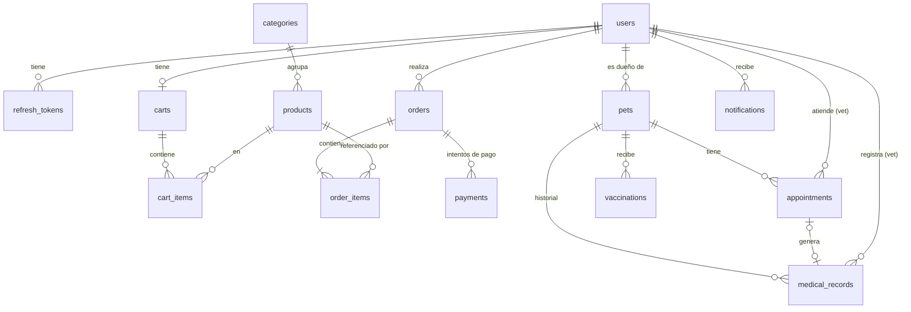

# Plan de Plutimi

> Qué vamos a construir y en qué orden. El **cómo** y el **porqué** están en
> [ARCHITECTURE.md](ARCHITECTURE.md).
>
> Marca las tareas con `[x]` a medida que se completen.

## Índice

1. [Módulos](#1-módulos)
2. [Modelo de datos](#2-modelo-de-datos)
3. [Endpoints](#3-endpoints)
4. [Plan por fases](#4-plan-por-fases)

---

## 1. Módulos

| Módulo | Responsabilidad | Fase |
|---|---|---|
| `shared` | Configuración transversal, manejo de errores, `Money`, `PageResponse`, auditoría, abstracción del usuario actual (`CurrentUserProvider`). | 1 |
| `user` | Usuarios: perfil, rol, activación. Gestión de usuarios por parte del admin. | 1 |
| `auth` | Registro, login, refresh y logout. Emisión y validación de JWT. Configuración de Spring Security. | 1 |
| `catalog` | Categorías y productos: CRUD (admin), catálogo público con filtros y paginación, stock. | 1 |
| `cart` | Carrito persistente del usuario autenticado. | 2 |
| `order` | Pedidos y sus líneas, estados (State), historial del cliente, gestión por el admin. | 2 |
| `payment` | Registro de pagos y pasarelas (Strategy): Culqi en modo prueba y un *fake* para desarrollo. | 2 |
| `checkout` | Orquesta la compra (Facade): carrito → pedido → pago. | 2 |
| `pet` | Mascotas de cada cliente. | 3 |
| `medicalrecord` | Historial clínico (consultas) y vacunas de cada mascota. | 3 |
| `appointment` | Agenda de citas veterinarias: disponibilidad, reserva y estados (State). | 3 |
| `notification` | Correos y notificaciones internas disparados por eventos (Observer); recordatorios programados. | 2 (correo básico) y 4 |

---

## 2. Modelo de datos

### Diagrama entidad-relación

### Tablas

Columnas comunes que no se repiten en cada tabla: `id BIGINT IDENTITY` y, salvo que se
indique lo contrario, `created_at` y `updated_at` (`TIMESTAMPTZ`).

#### Fase 1

**`users`** (módulo `user`)

| Columna | Tipo | Notas |
|---|---|---|
| `email` | `VARCHAR(255)` | Único, guardado en minúsculas |
| `password_hash` | `VARCHAR(100)` | BCrypt. Pasará a ser *nullable* cuando haya login con Google |
| `first_name`, `last_name` | `VARCHAR(100)` | |
| `phone` | `VARCHAR(20)` | Opcional |
| `role` | `VARCHAR(20)` | `CUSTOMER` \| `VET` \| `ADMIN` |
| `enabled` | `BOOLEAN` | El admin puede desactivar cuentas |

**`refresh_tokens`** (módulo `auth`)

| Columna | Tipo | Notas |
|---|---|---|
| `user_id` | FK → `users` | |
| `token_hash` | `VARCHAR(64)` | SHA-256 del token, único. El token en claro nunca se guarda |
| `expires_at` | `TIMESTAMPTZ` | |
| `revoked_at` | `TIMESTAMPTZ` | *Null* si está vigente |
| `created_at` | `TIMESTAMPTZ` | Sin `updated_at` |

**`categories`** (módulo `catalog`)

| Columna | Tipo | Notas |
|---|---|---|
| `name` | `VARCHAR(100)` | Único |
| `slug` | `VARCHAR(120)` | Único, para URLs amigables en el frontend (`alimento-perros`) |
| `description` | `TEXT` | Opcional |
| `active` | `BOOLEAN` | *Soft delete* |

**`products`** (módulo `catalog`)

| Columna | Tipo | Notas |
|---|---|---|
| `category_id` | FK → `categories` | `@ManyToOne` (mismo módulo) |
| `sku` | `VARCHAR(50)` | Único, código interno del producto |
| `name` | `VARCHAR(150)` | |
| `slug` | `VARCHAR(170)` | Único |
| `description` | `TEXT` | |
| `brand` | `VARCHAR(100)` | Filtro del catálogo |
| `price_amount` | `NUMERIC(12,2)` | `Money` (`@Embeddable`), `CHECK > 0` |
| `price_currency` | `CHAR(3)` | `PEN` |
| `stock` | `INTEGER` | `CHECK >= 0` |
| `image_url` | `VARCHAR(500)` | URL externa por ahora (subida de imágenes en la fase 4) |
| `active` | `BOOLEAN` | *Soft delete* |
| `version` | `BIGINT` | Bloqueo optimista |

#### Fase 2

**`carts`** (módulo `cart`): `user_id` (FK, único: un carrito por usuario).

**`cart_items`**

| Columna | Tipo | Notas |
|---|---|---|
| `cart_id` | FK → `carts` | |
| `product_id` | FK → `products` | Solo el ID (otro módulo) |
| `quantity` | `INTEGER` | `CHECK > 0`; único (`cart_id`, `product_id`) |

El carrito **no guarda precios**: siempre se muestra el precio actual del catálogo. El
precio se congela al crear el pedido.

**`orders`** (módulo `order`)

| Columna | Tipo | Notas |
|---|---|---|
| `user_id` | FK → `users` | Solo el ID |
| `status` | `VARCHAR(20)` | `PENDING_PAYMENT` \| `PAID` \| `SHIPPED` \| `DELIVERED` \| `CANCELLED` |
| `total_amount`, `currency` | `NUMERIC(12,2)`, `CHAR(3)` | `Money` |
| `shipping_recipient`, `shipping_phone`, `shipping_street`, `shipping_district`, `shipping_city`, `shipping_reference` | `VARCHAR` | `Address` (`@Embeddable`), copia de la dirección en el momento de la compra |
| `paid_at`, `shipped_at`, `delivered_at`, `cancelled_at` | `TIMESTAMPTZ` | Trazabilidad de estados |
| `version` | `BIGINT` | |

**`order_items`**

| Columna | Tipo | Notas |
|---|---|---|
| `order_id` | FK → `orders` | Agregado `Order` |
| `product_id` | FK → `products` | Solo el ID |
| `product_name` | `VARCHAR(150)` | Snapshot |
| `unit_price_amount` | `NUMERIC(12,2)` | Snapshot |
| `quantity` | `INTEGER` | `CHECK > 0` |

**`payments`** (módulo `payment`)

| Columna | Tipo | Notas |
|---|---|---|
| `order_id` | FK → `orders` | Un pedido puede tener varios intentos |
| `provider` | `VARCHAR(20)` | `CULQI` \| `FAKE` |
| `provider_charge_id` | `VARCHAR(100)` | ID del cargo en Culqi |
| `amount`, `currency` | `NUMERIC(12,2)`, `CHAR(3)` | |
| `status` | `VARCHAR(20)` | `SUCCEEDED` \| `FAILED` |
| `failure_reason` | `VARCHAR(255)` | Mensaje del proveedor si falló |

#### Fase 3

**`pets`** (módulo `pet`)

| Columna | Tipo | Notas |
|---|---|---|
| `owner_id` | FK → `users` | Solo el ID |
| `name` | `VARCHAR(80)` | |
| `species` | `VARCHAR(20)` | `DOG` \| `CAT` \| `BIRD` \| `RABBIT` \| `OTHER` |
| `breed` | `VARCHAR(80)` | Opcional |
| `sex` | `VARCHAR(10)` | `MALE` \| `FEMALE` \| `UNKNOWN` |
| `birth_date` | `DATE` | Opcional (a veces se desconoce) |
| `active` | `BOOLEAN` | *Soft delete* |

**`appointments`** (módulo `appointment`)

| Columna | Tipo | Notas |
|---|---|---|
| `pet_id` | FK → `pets` | |
| `vet_id` | FK → `users` | Usuario con rol `VET` |
| `scheduled_at` | `TIMESTAMPTZ` | Inicio del turno |
| `duration_minutes` | `INTEGER` | 30 por defecto |
| `type` | `VARCHAR(20)` | `CONSULTATION` \| `VACCINATION` \| `CHECKUP` \| `GROOMING` |
| `reason` | `VARCHAR(500)` | Motivo indicado por el cliente |
| `status` | `VARCHAR(20)` | `REQUESTED` \| `CONFIRMED` \| `COMPLETED` \| `CANCELLED` \| `NO_SHOW` |
| `cancellation_reason` | `VARCHAR(255)` | |
| `version` | `BIGINT` | |

Índice único parcial `(vet_id, scheduled_at) WHERE status IN ('REQUESTED','CONFIRMED')`:
la propia base de datos impide reservar dos veces el mismo turno, incluso con peticiones
simultáneas.

**`medical_records`** (módulo `medicalrecord`): una entrada por consulta.

| Columna | Tipo | Notas |
|---|---|---|
| `pet_id` | FK → `pets` | |
| `vet_id` | FK → `users` | |
| `appointment_id` | FK → `appointments` | Opcional, único |
| `visit_date` | `TIMESTAMPTZ` | |
| `weight_kg` | `NUMERIC(5,2)` | |
| `diagnosis`, `treatment`, `notes` | `TEXT` | |

Las entradas del historial **no se editan ni se borran** (valor legal y clínico). Las
correcciones se registran como una entrada nueva.

**`vaccinations`** (módulo `medicalrecord`)

| Columna | Tipo | Notas |
|---|---|---|
| `pet_id` | FK → `pets` | |
| `vet_id` | FK → `users` | |
| `vaccine_name` | `VARCHAR(100)` | |
| `applied_on` | `DATE` | |
| `next_due_on` | `DATE` | Opcional; base de los recordatorios de la fase 4 |
| `notes` | `TEXT` | |

#### Fase 4

**`notifications`** (módulo `notification`): `user_id`, `type`, `title`, `message`,
`read_at`, `created_at`.

---

## 3. Endpoints

Leyenda de acceso: 🌐 público · 👤 autenticado · 🛒 `CUSTOMER` · 🩺 `VET` · 🛡️ `ADMIN`.
Todos los listados admiten `page`, `size` y `sort`.

### `auth`

| Método | Ruta | Acceso | Descripción | Respuesta |
|---|---|---|---|---|
| POST | `/api/v1/auth/register` | 🌐 | Registro como `CUSTOMER` | 201 |
| POST | `/api/v1/auth/login` | 🌐 | Devuelve el access token y pone la cookie de refresh | 200 / 401 |
| POST | `/api/v1/auth/refresh` | 🌐 (cookie) | Rota el refresh token y devuelve un access token nuevo | 200 / 401 |
| POST | `/api/v1/auth/logout` | 👤 | Revoca el refresh token y borra la cookie | 204 |

### `user`

| Método | Ruta | Acceso | Descripción |
|---|---|---|---|
| GET | `/api/v1/users/me` | 👤 | Mi perfil |
| PUT | `/api/v1/users/me` | 👤 | Actualizar mi perfil |
| PUT | `/api/v1/users/me/password` | 👤 | Cambiar contraseña (revoca los refresh tokens) → 204 |
| GET | `/api/v1/users` | 🛡️ | Listar usuarios (`?role=`, `?q=`) |
| GET | `/api/v1/users/{id}` | 🛡️ | Detalle |
| PATCH | `/api/v1/users/{id}/role` | 🛡️ | Cambiar rol |
| PATCH | `/api/v1/users/{id}/status` | 🛡️ | Activar o desactivar |
| GET | `/api/v1/vets` | 🌐 | Veterinarios disponibles (para reservar citas) — fase 3 |

### `catalog`

| Método | Ruta | Acceso | Descripción |
|---|---|---|---|
| GET | `/api/v1/categories` | 🌐 | Listar categorías activas |
| GET | `/api/v1/categories/{id}` | 🌐 | Detalle |
| POST | `/api/v1/categories` | 🛡️ | Crear → 201 |
| PUT | `/api/v1/categories/{id}` | 🛡️ | Actualizar |
| DELETE | `/api/v1/categories/{id}` | 🛡️ | Desactivar → 204 (409 si tiene productos activos) |
| GET | `/api/v1/products` | 🌐 | Catálogo con filtros: `categoryId`, `q`, `brand`, `minPrice`, `maxPrice`, `inStock` |
| GET | `/api/v1/products/{id}` | 🌐 | Detalle |
| POST | `/api/v1/products` | 🛡️ | Crear → 201 |
| PUT | `/api/v1/products/{id}` | 🛡️ | Actualizar |
| PATCH | `/api/v1/products/{id}/stock` | 🛡️ | Ajustar stock |
| DELETE | `/api/v1/products/{id}` | 🛡️ | Desactivar → 204 |

### `cart`

| Método | Ruta | Acceso | Descripción |
|---|---|---|---|
| GET | `/api/v1/cart` | 🛒 | Ver mi carrito con precios actuales y total |
| POST | `/api/v1/cart/items` | 🛒 | Añadir producto (suma si ya estaba) |
| PUT | `/api/v1/cart/items/{productId}` | 🛒 | Fijar la cantidad |
| DELETE | `/api/v1/cart/items/{productId}` | 🛒 | Quitar producto → 204 |
| DELETE | `/api/v1/cart` | 🛒 | Vaciar → 204 |

### `checkout`, `order` y `payment`

| Método | Ruta | Acceso | Descripción |
|---|---|---|---|
| POST | `/api/v1/checkout` | 🛒 | Carrito + dirección + token de tarjeta → pedido (y pago). 201 con el pedido |
| GET | `/api/v1/orders` | 👤 | `CUSTOMER`: sus pedidos. `ADMIN`: todos (`?status=`, `?userId=`) |
| GET | `/api/v1/orders/{id}` | 👤 | Detalle (404 si es de otro cliente) |
| POST | `/api/v1/orders/{id}/payments` | 🛒 | Reintentar el pago de un pedido `PENDING_PAYMENT` → 201 |
| GET | `/api/v1/orders/{id}/payments` | 👤 | Intentos de pago del pedido |
| POST | `/api/v1/orders/{id}/cancel` | 👤 | Cancelar (cliente: solo si está pendiente; admin: también si está pagado) |
| POST | `/api/v1/orders/{id}/ship` | 🛡️ | Marcar como enviado |
| POST | `/api/v1/orders/{id}/deliver` | 🛡️ | Marcar como entregado |

### `pet` y `medicalrecord`

| Método | Ruta | Acceso | Descripción |
|---|---|---|---|
| GET | `/api/v1/pets` | 👤 | `CUSTOMER`: sus mascotas. `VET`/`ADMIN`: todas (`?ownerId=`, `?q=`) |
| POST | `/api/v1/pets` | 🛒 | Registrar mascota → 201 |
| GET | `/api/v1/pets/{id}` | 👤 | Detalle |
| PUT | `/api/v1/pets/{id}` | 🛒 | Actualizar |
| DELETE | `/api/v1/pets/{id}` | 🛒 | Desactivar → 204 |
| GET | `/api/v1/pets/{petId}/medical-records` | 👤 | Historial clínico (dueño, vet o admin) |
| POST | `/api/v1/pets/{petId}/medical-records` | 🩺 | Registrar consulta → 201 |
| GET | `/api/v1/medical-records/{id}` | 👤 | Detalle de una consulta |
| GET | `/api/v1/pets/{petId}/vaccinations` | 👤 | Carnet de vacunas |
| POST | `/api/v1/pets/{petId}/vaccinations` | 🩺 | Registrar vacuna → 201 |

### `appointment`

| Método | Ruta | Acceso | Descripción |
|---|---|---|---|
| GET | `/api/v1/appointments/availability` | 🌐 | Turnos libres: `?vetId=&date=` |
| POST | `/api/v1/appointments` | 🛒 | Solicitar cita para una de mis mascotas → 201 (409 si el turno se ocupó) |
| GET | `/api/v1/appointments` | 👤 | `CUSTOMER`: las suyas. `VET`: su agenda. `ADMIN`: todas. Filtros: `?from=&to=&status=` |
| GET | `/api/v1/appointments/{id}` | 👤 | Detalle |
| POST | `/api/v1/appointments/{id}/confirm` | 🩺🛡️ | Confirmar |
| POST | `/api/v1/appointments/{id}/cancel` | 👤 | Cancelar (cliente hasta 2 h antes) |
| POST | `/api/v1/appointments/{id}/complete` | 🩺 | Marcar como atendida (opcionalmente con la entrada del historial) |
| POST | `/api/v1/appointments/{id}/no-show` | 🩺 | Marcar inasistencia |

### `notification` (fase 4)

| Método | Ruta | Acceso | Descripción |
|---|---|---|---|
| GET | `/api/v1/notifications` | 👤 | Mis notificaciones (`?unread=true`) |
| POST | `/api/v1/notifications/{id}/read` | 👤 | Marcar como leída → 204 |
| GET | `/api/v1/notifications/stream` | 👤 | Tiempo real con Server-Sent Events |

---

## 4. Plan por fases

Cada tarea es pequeña (de una a pocas horas) y deja el proyecto compilando y arrancando.
Los tests se escriben **en cada fase** junto al código que prueban; la fase 4 añade
cobertura, CI y despliegue.

### Fase 0 — Entorno (completada)

- [x] Proyecto Spring Boot 4.1 con Java 21 y Maven
- [x] PostgreSQL 17 en Docker Compose (puerto 5434)
- [x] Conexión con Flyway y `ddl-auto=validate`

### Fase 1 — Base, catálogo y usuarios

**1.1 Base del proyecto**

- [ ] Renombrar `BackendApplication` a `PlutimiApplication`
- [ ] Perfiles: `application.properties` (común), `application-dev.properties`, `application-prod.properties` y `spring.profiles.default=dev`
- [ ] Añadir dependencias: springdoc-openapi, Spring Security, OAuth2 Resource Server (JWT) y Testcontainers
- [ ] `shared/config`: `OpenApiConfig` (título, versión, esquema *bearer*), `CorsConfig` (permitir `localhost:4200` en dev) y un bean `Clock`
- [ ] `shared/persistence`: `AuditableEntity` + `@EnableJpaAuditing`
- [ ] `shared/money`: Value Object `Money` (`@Embeddable`) con tests unitarios
- [ ] `shared/web`: `PageResponse<T>` y límite máximo de `size` (100)

**1.2 Manejo de errores**

- [ ] `shared/exception`: `ApplicationException`, `ResourceNotFoundException`, `ConflictException`, `BusinessException`
- [ ] `GlobalExceptionHandler` con `ProblemDetail`: 404, 409, 422 y 500 (con log)
- [ ] Errores de validación (400) con la lista `errors` de campos
- [ ] JSON mal formado (400), bloqueo optimista (409) y violación de *constraints* (409)
- [ ] Tests con `@WebMvcTest` de cada tipo de error

**1.3 Categorías**

- [ ] `V1__create_categories_table.sql`
- [ ] Entidad `Category` y `CategoryRepository`
- [ ] DTOs (`CreateCategoryRequest`, `UpdateCategoryRequest`, `CategoryResponse`) y `CategoryMapper`
- [ ] `CategoryService`: crear, actualizar, obtener, listar paginado y desactivar
- [ ] `CategoryController` con 201 + `Location`, 204 y 404
- [ ] Generación del `slug` y unicidad de nombre y slug (409)
- [ ] Tests: unitario del service e integración con Testcontainers

**1.4 Productos**

- [ ] `V2__create_products_table.sql`
- [ ] Entidad `Product` con `Money` y métodos `decreaseStock`, `increaseStock`, `changePrice` y `deactivate`
- [ ] `ProductRepository` + `JpaSpecificationExecutor`
- [ ] DTOs, `ProductMapper` y `ProductService` (CRUD y ajuste de stock)
- [ ] `ProductSpecifications` + `ProductFilter`: categoría, texto, marca, rango de precio y stock
- [ ] `ProductController` (GET público, escritura solo para admin; la seguridad se activa en 1.6)
- [ ] Tests: reglas de `Product`, Specifications con Testcontainers y controller

**1.5 Usuarios**

- [ ] `V3__create_users_table.sql`
- [ ] Entidad `User` y enum `Role` en `shared/security`
- [ ] `UserService`: perfil propio, listado y cambio de rol o estado (admin)
- [ ] Usuario admin inicial: `AdminInitializer` (`ApplicationRunner`) que, si no existe ningún admin, lo crea con `ADMIN_EMAIL` y `ADMIN_PASSWORD` del entorno (nunca una contraseña escrita en una migración)

**1.6 Autenticación y seguridad**

- [ ] `V4__create_refresh_tokens_table.sql`
- [ ] `shared/security`: `AuthenticatedUser` e interfaz `CurrentUserProvider`
- [ ] `auth`: `JwtProperties` (`@ConfigurationProperties`), `JwtEncoder` y `JwtDecoder` con HS256
- [ ] `SecurityConfig`: *stateless*, rutas públicas, 401/403 con `ProblemDetail` y `@EnableMethodSecurity`
- [ ] Conversor JWT → `AuthenticatedUser` y `SecurityContextCurrentUserProvider`
- [ ] `POST /auth/register` con BCrypt y 409 si el email existe
- [ ] `POST /auth/login`: access token + cookie `HttpOnly` con el refresh token
- [ ] `POST /auth/refresh` con rotación y detección de reutilización
- [ ] `POST /auth/logout`
- [ ] `@PreAuthorize` en los endpoints de admin de catálogo y usuarios
- [ ] Endpoints `/users/me` (perfil y cambio de contraseña)
- [ ] Swagger: botón *Authorize* con *bearer token*
- [ ] Tests: registro y login, acceso por rol (401/403) y refresh

**1.7 Cierre de la fase 1**

- [ ] Recorrer todo el flujo en Swagger: registro → login → crear categoría y producto como admin → catálogo público
- [ ] README con instrucciones para levantar el proyecto

### Fase 2 — Carrito, pedidos y pago

**2.1 Carrito**

- [ ] `V5__create_carts_tables.sql` (`carts` + `cart_items`)
- [ ] Entidades `Cart` y `CartItem` con `addItem`, `changeQuantity`, `removeItem` y `clear`
- [ ] `CartService`: validar que el producto existe, está activo y tiene stock (usando `ProductService`)
- [ ] `CartController` y tests

**2.2 Pedidos**

- [ ] `V6__create_orders_tables.sql` (`orders` + `order_items`)
- [ ] Value Object `Address` (`@Embeddable`)
- [ ] `OrderStatus` con transiciones (State) y tests de todas las transiciones
- [ ] Entidad `Order`: `create`, `markAsPaid`, `ship`, `deliver` y `cancel`
- [ ] `OrderService`: crear desde el carrito (reservando stock), listar según rol, detalle con control de propiedad
- [ ] Cancelación con devolución de stock
- [ ] Acciones de admin: `ship` y `deliver`
- [ ] Prueba de concurrencia: dos compras del último producto → una recibe 409

**2.3 Pagos**

- [ ] `V7__create_payments_table.sql`
- [ ] Interfaz `PaymentGateway`, `FakePaymentGateway` y `PaymentGatewayResolver` (Strategy)
- [ ] `CulqiPaymentGateway` con un cliente HTTP (`RestClient`) y claves de prueba por variables de entorno
- [ ] `PaymentService`: registrar el intento y traducir errores del proveedor
- [ ] Reintento de pago: `POST /orders/{id}/payments`

**2.4 Checkout**

- [ ] `CheckoutFacade`: validar el carrito → crear el pedido (Tx 1) → cobrar (sin transacción) → marcar como pagado (Tx 2) → vaciar el carrito
- [ ] `CheckoutController`
- [ ] Tarea `@Scheduled` que cancela pedidos sin pagar después de 30 minutos
- [ ] Tests del flujo completo con `FakePaymentGateway`

**2.5 Correo básico (Observer)**

- [ ] Mailpit en `docker-compose.yml` para ver los correos en local
- [ ] `EmailClient` con `JavaMailSender`
- [ ] `OrderPaidEvent` → `OrderEmailListener` (`@TransactionalEventListener` + `@Async`)

### Fase 3 — Veterinaria

**3.1 Mascotas**

- [ ] `V8__create_pets_table.sql`
- [ ] Entidad `Pet`, service con control de propiedad (cliente frente a vet o admin) y controller
- [ ] Tests

**3.2 Historial clínico y vacunas**

- [ ] `V9__create_medical_records_table.sql` y `V10__create_vaccinations_table.sql`
- [ ] Entidades, services y controllers (escritura solo para `VET`)
- [ ] El historial es de solo inserción: sin PUT ni DELETE
- [ ] Tests de permisos: el dueño lee, el vet escribe y los demás reciben 404

**3.3 Citas**

- [ ] `V11__create_appointments_table.sql` con índice único parcial anti doble reserva
- [ ] `AppointmentStatus` (State) y entidad `Appointment` con `confirm`, `cancel`, `complete` y `markNoShow`
- [ ] Configuración del horario de atención (`@ConfigurationProperties`: días, horas y duración del turno)
- [ ] Cálculo de disponibilidad (`/availability`) = horario − citas activas
- [ ] Reserva con validaciones (mascota propia, turno futuro y libre, rol `VET`) y 409 por conflicto
- [ ] `GET /api/v1/vets`
- [ ] `complete` con creación opcional de la entrada del historial
- [ ] Eventos `AppointmentConfirmedEvent` / `AppointmentCancelledEvent` → correo
- [ ] Tests, incluida la reserva concurrente del mismo turno

### Fase 4 — Extras, calidad y despliegue

**4.1 Notificaciones**

- [ ] `V12__create_notifications_table.sql`; los listeners existentes también crean notificaciones internas
- [ ] Endpoints de notificaciones y *stream* SSE en tiempo real
- [ ] Recordatorios programados (`@Scheduled`): cita del día siguiente y vacunas próximas a vencer

**4.2 Calidad**

- [ ] Verificar las fronteras entre módulos con Spring Modulith o ArchUnit
- [ ] Informe de cobertura con JaCoCo
- [ ] Revisar los tests de integración de los flujos críticos (checkout y citas)
- [ ] Límite de intentos de login (protección contra fuerza bruta)

**4.3 CI**

- [ ] GitHub Actions: compilación y tests (Testcontainers) en cada *push* y PR
- [ ] Publicar el informe de cobertura

**4.4 Despliegue**

- [ ] `Dockerfile` multi-stage del backend
- [ ] Spring Boot Actuator (`/actuator/health`) para el *healthcheck*
- [ ] `docker-compose.prod.yml`: Nginx + backend + PostgreSQL (sin exponer el puerto de la base de datos)
- [ ] Nginx como *reverse proxy* con HTTPS (Let's Encrypt) en `plutimi.andymallcco.dev`
- [ ] Variables de entorno de producción en el VPS y Swagger desactivado en `prod`
- [ ] Copias de seguridad de PostgreSQL (`pg_dump` programado)
- [ ] Despliegue automático desde GitHub Actions (opcional)

**4.5 Opcionales**

- [ ] Login con Google (OAuth2), validando el aislamiento de `auth`
- [ ] Segunda pasarela de pago (Mercado Pago) como otra Strategy
- [ ] Subida de imágenes de productos
- [ ] MapStruct en lugar de los mappers manuales
