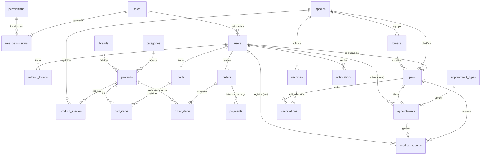

# Plan de Plutimi

> Qué vamos a construir y en qué orden. El **cómo** y el **porqué** están en
> [ARCHITECTURE.md](ARCHITECTURE.md).
>
> Marca las tareas con `[x]` a medida que se completen.

## Índice

1. [Módulos](#1-módulos)
2. [Modelo de datos](#2-modelo-de-datos)
3. [Roles y permisos](#3-roles-y-permisos)
4. [Datos iniciales (seeders)](#4-datos-iniciales-seeders)
5. [Endpoints](#5-endpoints)
6. [Plan por fases](#6-plan-por-fases)

---

## 1. Módulos

| Módulo | Responsabilidad | Fase |
|---|---|---|
| `shared` | Configuración transversal, manejo de errores, `Money`, `PageResponse`, auditoría, abstracción del usuario actual (`CurrentUserProvider`). | 1 |
| `species` | Datos de referencia de especies y razas, compartidos por el catálogo y la veterinaria. | 1 |
| `catalog` | Categorías, marcas y productos: CRUD, catálogo público con filtros y paginación, stock. | 1 |
| `user` | Usuarios, roles y permisos (RBAC). Perfil propio y gestión por parte del admin. | 1 |
| `auth` | Registro, login, refresh y logout. Emisión y validación de JWT. Configuración de Spring Security. | 1 |
| `cart` | Carrito persistente del usuario autenticado. | 2 |
| `order` | Pedidos y sus líneas, estados (State), historial del cliente, gestión por el admin. | 2 |
| `payment` | Registro de pagos y pasarelas (Strategy): Culqi en modo prueba y un *fake* para desarrollo. | 2 |
| `checkout` | Orquesta la compra (Facade): carrito → pedido → pago. | 2 |
| `pet` | Mascotas de cada cliente. | 3 |
| `medicalrecord` | Historial clínico (consultas), catálogo de vacunas y vacunas aplicadas. | 3 |
| `appointment` | Tipos de cita, agenda veterinaria: disponibilidad, reserva y estados (State). | 3 |
| `notification` | Correos y notificaciones internas disparados por eventos (Observer); recordatorios programados. | 2 (correo básico) y 4 |

---

## 2. Modelo de datos

### Diagrama entidad-relación



### Tablas

Columnas comunes que no se repiten en cada tabla: `id BIGINT IDENTITY` y, salvo que se
indique lo contrario, `created_at` y `updated_at` (`TIMESTAMPTZ`). Las tablas de unión
N:M (`role_permissions`, `product_species`) no tienen `id` ni fechas: su clave primaria es
compuesta.

Las tablas marcadas como **referencia** contienen datos que el código necesita para
funcionar y se cargan con migraciones en todos los entornos
(ver [sección 4](#4-datos-iniciales-seeders)).

#### Fase 1

**`roles`** (módulo `user`, referencia)

| Columna | Tipo | Notas |
|---|---|---|
| `code` | `VARCHAR(30)` | Único, en mayúsculas: `CUSTOMER`, `VET`, `ADMIN` |
| `name` | `VARCHAR(60)` | Nombre visible: "Cliente", "Veterinario", "Administrador" |
| `description` | `VARCHAR(255)` | |
| `system` | `BOOLEAN` | `true` en los tres roles base: no se pueden borrar ni cambiar su `code` |

**`permissions`** (módulo `user`, referencia)

| Columna | Tipo | Notas |
|---|---|---|
| `code` | `VARCHAR(60)` | Único, formato `<recurso>:<acción>` (ej. `catalog:manage`) |
| `description` | `VARCHAR(255)` | Texto para la pantalla de administración |

Solo se crean con migraciones: un permiso sin código que lo compruebe no sirve de nada.
Sin `updated_at`.

**`role_permissions`** (módulo `user`, referencia)

| Columna | Tipo | Notas |
|---|---|---|
| `role_id` | FK → `roles` | `ON DELETE CASCADE` |
| `permission_id` | FK → `permissions` | `ON DELETE CASCADE` |

PK compuesta (`role_id`, `permission_id`): impide asignar dos veces el mismo permiso.

**`users`** (módulo `user`)

| Columna | Tipo | Notas |
|---|---|---|
| `email` | `VARCHAR(255)` | Único, guardado en minúsculas |
| `password_hash` | `VARCHAR(100)` | BCrypt. Pasará a ser *nullable* cuando haya login con Google |
| `first_name`, `last_name` | `VARCHAR(100)` | |
| `phone` | `VARCHAR(20)` | Opcional |
| `role_id` | FK → `roles` | Un rol por usuario. `@ManyToOne` (mismo módulo) |
| `enabled` | `BOOLEAN` | El admin puede desactivar cuentas |

**`refresh_tokens`** (módulo `auth`)

| Columna | Tipo | Notas |
|---|---|---|
| `user_id` | FK → `users` | |
| `token_hash` | `VARCHAR(64)` | SHA-256 del token, único. El token en claro nunca se guarda |
| `expires_at` | `TIMESTAMPTZ` | |
| `revoked_at` | `TIMESTAMPTZ` | *Null* si está vigente |
| `created_at` | `TIMESTAMPTZ` | Sin `updated_at` |

**`species`** (módulo `species`, referencia)

| Columna | Tipo | Notas |
|---|---|---|
| `code` | `VARCHAR(30)` | Único: `DOG`, `CAT`, `BIRD`, `RABBIT`, `RODENT`, `FISH`, `REPTILE` |
| `name` | `VARCHAR(60)` | Único, nombre visible: "Perro", "Gato"... |
| `active` | `BOOLEAN` | |

**`breeds`** (módulo `species`, referencia)

| Columna | Tipo | Notas |
|---|---|---|
| `species_id` | FK → `species` | `@ManyToOne` (mismo módulo) |
| `name` | `VARCHAR(80)` | Único por especie (`species_id`, `name`). Cada especie incluye "Mestizo" o "Común" |
| `active` | `BOOLEAN` | |

Además, `UNIQUE (id, species_id)`: es el destino de la FK compuesta de `pets` que
garantiza que la raza pertenece a la especie.

**`categories`** (módulo `catalog`)

| Columna | Tipo | Notas |
|---|---|---|
| `name` | `VARCHAR(100)` | Único |
| `slug` | `VARCHAR(120)` | Único, para URLs amigables en el frontend (`alimento-perros`) |
| `description` | `TEXT` | Opcional |
| `active` | `BOOLEAN` | *Soft delete* |

**`brands`** (módulo `catalog`)

| Columna | Tipo | Notas |
|---|---|---|
| `name` | `VARCHAR(100)` | Único |
| `slug` | `VARCHAR(120)` | Único |
| `active` | `BOOLEAN` | *Soft delete* |

**`products`** (módulo `catalog`)

| Columna | Tipo | Notas |
|---|---|---|
| `category_id` | FK → `categories` | `@ManyToOne` (mismo módulo) |
| `brand_id` | FK → `brands` | Opcional (productos sin marca). `@ManyToOne` |
| `sku` | `VARCHAR(50)` | Único, código interno del producto |
| `name` | `VARCHAR(150)` | |
| `slug` | `VARCHAR(170)` | Único |
| `description` | `TEXT` | |
| `price_amount` | `NUMERIC(12,2)` | `Money` (`@Embeddable`), `CHECK > 0` |
| `price_currency` | `CHAR(3)` | `PEN` |
| `stock` | `INTEGER` | `CHECK >= 0` |
| `image_url` | `VARCHAR(500)` | URL externa por ahora (subida de imágenes en la fase 4) |
| `active` | `BOOLEAN` | *Soft delete* |
| `version` | `BIGINT` | Bloqueo optimista |

**`product_species`** (módulo `catalog`)

| Columna | Tipo | Notas |
|---|---|---|
| `product_id` | FK → `products` | `ON DELETE CASCADE` |
| `species_id` | FK → `species` | Otro módulo: en Java es un `Set<Long>` (`@ElementCollection`) |

PK compuesta (`product_id`, `species_id`). Todo producto indica **al menos una** especie;
un comedero genérico lista perro y gato.

#### Fase 2

**`carts`** (módulo `cart`): `user_id` (FK, único: un carrito por usuario).

**`cart_items`**

| Columna | Tipo | Notas |
|---|---|---|
| `cart_id` | FK → `carts` | |
| `product_id` | FK → `products` | Solo el ID (otro módulo) |
| `quantity` | `INTEGER` | `CHECK > 0`; único (`cart_id`, `product_id`) |

El carrito **no guarda precios**: siempre se muestra el precio actual del catálogo. El
precio se congela al crear el pedido.

**`orders`** (módulo `order`)

| Columna | Tipo | Notas |
|---|---|---|
| `user_id` | FK → `users` | Solo el ID |
| `status` | `VARCHAR(20)` | Enum: `PENDING_PAYMENT` \| `PAID` \| `SHIPPED` \| `DELIVERED` \| `CANCELLED` |
| `total_amount`, `currency` | `NUMERIC(12,2)`, `CHAR(3)` | `Money` |
| `shipping_recipient`, `shipping_phone`, `shipping_street`, `shipping_district`, `shipping_city`, `shipping_reference` | `VARCHAR` | `Address` (`@Embeddable`), copia **intencionada** de la dirección en el momento de la compra |
| `paid_at`, `shipped_at`, `delivered_at`, `cancelled_at` | `TIMESTAMPTZ` | Trazabilidad de estados |
| `version` | `BIGINT` | |

**`order_items`**

| Columna | Tipo | Notas |
|---|---|---|
| `order_id` | FK → `orders` | Agregado `Order` |
| `product_id` | FK → `products` | Solo el ID |
| `product_name` | `VARCHAR(150)` | Snapshot |
| `unit_price_amount` | `NUMERIC(12,2)` | Snapshot |
| `quantity` | `INTEGER` | `CHECK > 0` |

**`payments`** (módulo `payment`)

| Columna | Tipo | Notas |
|---|---|---|
| `order_id` | FK → `orders` | Un pedido puede tener varios intentos |
| `provider` | `VARCHAR(20)` | Enum: `CULQI` \| `FAKE` (cada valor es una Strategy) |
| `provider_charge_id` | `VARCHAR(100)` | ID del cargo en Culqi |
| `amount`, `currency` | `NUMERIC(12,2)`, `CHAR(3)` | |
| `status` | `VARCHAR(20)` | `SUCCEEDED` \| `FAILED` |
| `failure_reason` | `VARCHAR(255)` | Mensaje del proveedor si falló |

#### Fase 3

**`pets`** (módulo `pet`)

| Columna | Tipo | Notas |
|---|---|---|
| `owner_id` | FK → `users` | Solo el ID |
| `name` | `VARCHAR(80)` | |
| `species_id` | FK → `species` | Obligatorio. Solo el ID (otro módulo) |
| `breed_id` | `BIGINT` | Opcional. FK **compuesta** (`breed_id`, `species_id`) → `breeds (id, species_id)` |
| `sex` | `VARCHAR(10)` | Enum: `MALE` \| `FEMALE` \| `UNKNOWN` |
| `birth_date` | `DATE` | Opcional (a veces se desconoce) |
| `active` | `BOOLEAN` | *Soft delete* |

La FK compuesta hace que PostgreSQL rechace una mascota "gato" con raza "Labrador". Si
`breed_id` es `NULL`, la FK no se evalúa (comportamiento `MATCH SIMPLE`), así que la raza
sigue siendo opcional. El service valida lo mismo antes, para devolver un mensaje claro.

**`vaccines`** (módulo `medicalrecord`, referencia)

| Columna | Tipo | Notas |
|---|---|---|
| `species_id` | FK → `species` | Especie a la que se aplica |
| `name` | `VARCHAR(100)` | Único por especie: "Antirrábica", "Séxtuple", "Triple felina"... |
| `booster_interval_days` | `INTEGER` | Intervalo de refuerzo; `NULL` si es de dosis única. `CHECK > 0` |
| `active` | `BOOLEAN` | |

**`vaccinations`** (módulo `medicalrecord`)

| Columna | Tipo | Notas |
|---|---|---|
| `pet_id` | FK → `pets` | |
| `vaccine_id` | FK → `vaccines` | La vacuna debe ser de la especie de la mascota (validado en el service) |
| `vet_id` | FK → `users` | |
| `applied_on` | `DATE` | |
| `next_due_on` | `DATE` | Se propone `applied_on + booster_interval_days`; el vet puede ajustarla. Base de los recordatorios |
| `notes` | `TEXT` | |

**`medical_records`** (módulo `medicalrecord`): una entrada por consulta.

| Columna | Tipo | Notas |
|---|---|---|
| `pet_id` | FK → `pets` | |
| `vet_id` | FK → `users` | |
| `appointment_id` | FK → `appointments` | Opcional, único |
| `visit_date` | `TIMESTAMPTZ` | |
| `weight_kg` | `NUMERIC(5,2)` | |
| `diagnosis`, `treatment`, `notes` | `TEXT` | |

Las entradas del historial **no se editan ni se borran** (valor legal y clínico). Las
correcciones se registran como una entrada nueva.

**`appointment_types`** (módulo `appointment`, referencia)

| Columna | Tipo | Notas |
|---|---|---|
| `name` | `VARCHAR(80)` | Único: "Consulta general", "Vacunación", "Baño y corte"... |
| `description` | `VARCHAR(255)` | |
| `duration_minutes` | `INTEGER` | `CHECK (duration_minutes > 0 AND duration_minutes % 30 = 0)`: múltiplo del turno base |
| `active` | `BOOLEAN` | |

**`appointments`** (módulo `appointment`)

| Columna | Tipo | Notas |
|---|---|---|
| `pet_id` | FK → `pets` | |
| `vet_id` | FK → `users` | Usuario con rol `VET` |
| `appointment_type_id` | FK → `appointment_types` | |
| `scheduled_at` | `TIMESTAMPTZ` | Inicio. `CHECK` de alineación a la grilla de 30 min |
| `ends_at` | `TIMESTAMPTZ` | Fin = inicio + duración del tipo **en el momento de reservar** (snapshot). `CHECK (ends_at > scheduled_at)` y alineado a la grilla |
| `reason` | `VARCHAR(500)` | Motivo indicado por el cliente |
| `status` | `VARCHAR(20)` | Enum: `REQUESTED` \| `CONFIRMED` \| `COMPLETED` \| `CANCELLED` \| `NO_SHOW` |
| `cancellation_reason` | `VARCHAR(255)` | |
| `version` | `BIGINT` | |

Protección contra doble reserva con una **restricción de exclusión** (requiere la extensión
`btree_gist`):

```sql
CONSTRAINT ex_appointments_vet_period EXCLUDE USING gist (
    vet_id WITH =,
    tstzrange(scheduled_at, ends_at) WITH &&
) WHERE (status IN ('REQUESTED', 'CONFIRMED'))
```

Se lee así: "no pueden existir dos citas activas del mismo veterinario (`=`) cuyos
intervalos se solapen (`&&`)". El rango `[inicio, fin)` es semiabierto, así que una cita
de 10:00 a 11:00 y otra de 11:00 a 11:30 **no** se solapan. Los detalles y el algoritmo
de disponibilidad están en [ARCHITECTURE.md §7](ARCHITECTURE.md#7-base-de-datos-y-migraciones).

#### Fase 4

**`notifications`** (módulo `notification`): `user_id`, `type` (enum), `title`, `message`,
`read_at`, `created_at`.

### Qué se queda como enum y por qué

| Enum | Motivo |
|---|---|
| `OrderStatus`, `AppointmentStatus` | Cada valor tiene comportamiento (transiciones del patrón State) |
| `PaymentProvider` | Cada valor corresponde a una clase Strategy |
| `PetSex`, `PaymentStatus`, `NotificationType` | Valores fijos, sin gestión por el admin |
| Moneda (`CHAR(3)`) | Estándar ISO 4217 |

---

## 3. Roles y permisos

Formato del código de un permiso: `<recurso>:<acción>`, en minúsculas y *kebab-case*. Los
endpoints comprueban **permisos**, nunca roles:
`@PreAuthorize("hasAuthority('catalog:manage')")`.

Los permisos `*:read-all` no protegen un endpoint: los usa el service para decidir si
filtra por propietario ("mis pedidos") o muestra todo.

| Permiso | Qué permite | CUSTOMER | VET | ADMIN | Fase |
|---|---|:-:|:-:|:-:|:-:|
| `catalog:manage` | CRUD de categorías, marcas y productos; ajustar stock | | | ✓ | 1 |
| `species:manage` | CRUD de especies y razas | | | ✓ | 1 |
| `user:read` | Listar y ver usuarios | | | ✓ | 1 |
| `user:manage` | Cambiar el rol o el estado de un usuario | | | ✓ | 1 |
| `role:manage` | Crear roles y asignarles permisos | | | ✓ | 1 |
| `order:create` | Usar el carrito, hacer checkout y pagar | ✓ | | ✓ | 2 |
| `order:read-all` | Ver los pedidos de todos los clientes | | | ✓ | 2 |
| `order:manage` | Enviar, entregar o cancelar pedidos pagados | | | ✓ | 2 |
| `pet:manage-own` | Registrar y editar sus propias mascotas | ✓ | | | 3 |
| `pet:read-all` | Ver todas las mascotas | | ✓ | ✓ | 3 |
| `medical-record:write` | Registrar consultas y vacunas aplicadas | | ✓ | | 3 |
| `medical-record:read-all` | Ver el historial de cualquier mascota | | ✓ | ✓ | 3 |
| `vaccine:manage` | CRUD del catálogo de vacunas | | | ✓ | 3 |
| `appointment:book` | Reservar citas para sus mascotas | ✓ | | | 3 |
| `appointment:read-all` | Ver la agenda completa | | ✓ | ✓ | 3 |
| `appointment:manage` | Confirmar, completar, marcar inasistencia o cancelar cualquier cita | | ✓ | ✓ | 3 |
| `appointment-type:manage` | CRUD de tipos de cita | | | ✓ | 3 |

Solo hay **dos lugares** donde el código usa un código de rol: el registro asigna
`CUSTOMER` y `GET /vets` lista los usuarios con rol `VET`. Todo lo demás depende de
permisos, así que el admin puede crear roles nuevos (por ejemplo `STOCK_MANAGER` solo con
`catalog:manage`) sin cambiar código.

---

## 4. Datos iniciales (seeders)

| Nivel | Qué contiene | Dónde | Entornos |
|---|---|---|---|
| **Referencia** | Roles, permisos y su asignación; especies y razas; catálogo de vacunas; tipos de cita | Migraciones versionadas `V<n>__insert_...sql` en `db/migration` | Todos (dev, test, prod) |
| **Demostración** | Usuarios de prueba de cada rol, marcas, categorías, productos y mascotas | Migraciones **repetibles** `R__demo_<nn>_<tema>.sql` en `db/demo` | Solo `dev` |
| **Admin de producción** | Primer usuario `ADMIN` | `AdminInitializer` con `ADMIN_EMAIL` y `ADMIN_PASSWORD` del entorno | Solo si no existe ningún admin |

- `application-dev.properties` añade la ubicación:
  `spring.flyway.locations=classpath:db/migration,classpath:db/demo`.
- Los tests usan el perfil `test`, que no incluye `db/demo`: cada test crea sus propios datos.
- Los usuarios demo (`admin@plutimi.dev`, `vet@plutimi.dev`, `cliente@plutimi.dev`)
  comparten una contraseña de desarrollo documentada en el README, guardada como hash
  BCrypt en el SQL. No es un secreto: esos usuarios no existen fuera de `dev`.
- Archivos demo previstos: `R__demo_01_catalog.sql` (1.5), `R__demo_02_users.sql` (1.6) y
  `R__demo_03_pets.sql` (3.1). Por qué son repetibles e idempotentes: ver
  [ARCHITECTURE.md §7](ARCHITECTURE.md#7-base-de-datos-y-migraciones).

### Orden de las migraciones

El número definitivo es el siguiente libre al implementar cada tarea; esta tabla fija el
**orden**.

| # | Migración | Sección |
|---|---|---|
| V1 | `create_categories_table` | 1.3 |
| V2 | `create_species_and_breeds_tables` | 1.4 |
| V3 | `insert_species_and_breeds` | 1.4 |
| V4 | `create_brands_table` | 1.5 |
| V5 | `create_products_tables` (`products` + `product_species`) | 1.5 |
| V6 | `create_rbac_tables` (`roles`, `permissions`, `role_permissions`) | 1.6 |
| V7 | `insert_roles_and_permissions` (roles base + permisos de la fase 1) | 1.6 |
| V8 | `create_users_table` | 1.6 |
| V9 | `create_refresh_tokens_table` | 1.7 |
| V10 | `create_carts_tables` | 2.1 |
| V11 | `create_orders_tables` | 2.2 |
| V12 | `insert_order_permissions` | 2.2 |
| V13 | `create_payments_table` | 2.3 |
| V14 | `insert_veterinary_permissions` | 3.1 |
| V15 | `create_pets_table` | 3.1 |
| V16 | `create_vaccines_table` | 3.2 |
| V17 | `insert_vaccines` | 3.2 |
| V18 | `create_medical_records_table` | 3.2 |
| V19 | `create_vaccinations_table` | 3.2 |
| V20 | `create_appointment_types_table` | 3.3 |
| V21 | `insert_appointment_types` | 3.3 |
| V22 | `create_appointments_table` (con `btree_gist` y la restricción de exclusión) | 3.3 |
| V23 | `create_notifications_table` | 4.1 |

Las migraciones `R__demo_*` se ejecutan después de todas las versionadas, y solo en `dev`.

---

## 5. Endpoints

Leyenda de acceso: 🌐 público · 👤 autenticado (con control de propiedad en el service) ·
`código` = permiso requerido. Todos los listados admiten `page`, `size` y `sort`.

### `auth`

| Método | Ruta | Acceso | Descripción | Respuesta |
|---|---|---|---|---|
| POST | `/api/v1/auth/register` | 🌐 | Registro con el rol `CUSTOMER` | 201 |
| POST | `/api/v1/auth/login` | 🌐 | Devuelve el access token y pone la cookie de refresh | 200 / 401 |
| POST | `/api/v1/auth/refresh` | 🌐 (cookie) | Rota el refresh token y devuelve un access token nuevo con los permisos actualizados | 200 / 401 |
| POST | `/api/v1/auth/logout` | 👤 | Revoca el refresh token y borra la cookie | 204 |

### `user` (usuarios, roles y permisos)

| Método | Ruta | Acceso | Descripción |
|---|---|---|---|
| GET | `/api/v1/users/me` | 👤 | Mi perfil, con mi rol y mis permisos |
| PUT | `/api/v1/users/me` | 👤 | Actualizar mi perfil |
| PUT | `/api/v1/users/me/password` | 👤 | Cambiar contraseña (revoca los refresh tokens) → 204 |
| GET | `/api/v1/users` | `user:read` | Listar usuarios (`?roleId=`, `?q=`) |
| GET | `/api/v1/users/{id}` | `user:read` | Detalle |
| PATCH | `/api/v1/users/{id}/role` | `user:manage` | Cambiar rol (`{ "roleId": 2 }`); revoca sus refresh tokens |
| PATCH | `/api/v1/users/{id}/status` | `user:manage` | Activar o desactivar; revoca sus refresh tokens |
| GET | `/api/v1/roles` | `role:manage` | Roles con sus permisos |
| GET | `/api/v1/roles/{id}` | `role:manage` | Detalle |
| POST | `/api/v1/roles` | `role:manage` | Crear rol → 201 |
| PUT | `/api/v1/roles/{id}` | `role:manage` | Cambiar nombre y descripción (el `code` de un rol de sistema no cambia) |
| PUT | `/api/v1/roles/{id}/permissions` | `role:manage` | Reemplazar el conjunto de permisos (`{ "permissionIds": [...] }`) |
| DELETE | `/api/v1/roles/{id}` | `role:manage` | Borrar → 204 (409 si es de sistema o tiene usuarios) |
| GET | `/api/v1/permissions` | `role:manage` | Catálogo de permisos (solo lectura) |
| GET | `/api/v1/vets` | 🌐 | Veterinarios (usuarios con rol `VET`) para reservar citas — fase 3 |

### `species`

| Método | Ruta | Acceso | Descripción |
|---|---|---|---|
| GET | `/api/v1/species` | 🌐 | Especies activas |
| GET | `/api/v1/species/{id}/breeds` | 🌐 | Razas de una especie |
| POST | `/api/v1/species` | `species:manage` | Crear especie → 201 |
| PUT | `/api/v1/species/{id}` | `species:manage` | Actualizar |
| POST | `/api/v1/species/{id}/breeds` | `species:manage` | Crear raza → 201 |
| PUT | `/api/v1/breeds/{id}` | `species:manage` | Actualizar raza |
| DELETE | `/api/v1/species/{id}`, `/api/v1/breeds/{id}` | `species:manage` | Desactivar → 204 |

### `catalog`

| Método | Ruta | Acceso | Descripción |
|---|---|---|---|
| GET | `/api/v1/categories` | 🌐 | Listar categorías activas |
| GET | `/api/v1/categories/{id}` | 🌐 | Detalle |
| POST | `/api/v1/categories` | `catalog:manage` | Crear → 201 |
| PUT | `/api/v1/categories/{id}` | `catalog:manage` | Actualizar |
| DELETE | `/api/v1/categories/{id}` | `catalog:manage` | Desactivar → 204 (409 si tiene productos activos) |
| GET | `/api/v1/brands` | 🌐 | Listar marcas activas |
| POST | `/api/v1/brands` | `catalog:manage` | Crear → 201 |
| PUT | `/api/v1/brands/{id}` | `catalog:manage` | Actualizar |
| DELETE | `/api/v1/brands/{id}` | `catalog:manage` | Desactivar → 204 |
| GET | `/api/v1/products` | 🌐 | Catálogo con filtros: `categoryId`, `brandId`, `speciesId`, `q`, `minPrice`, `maxPrice`, `inStock` |
| GET | `/api/v1/products/{id}` | 🌐 | Detalle, con marca y especies |
| POST | `/api/v1/products` | `catalog:manage` | Crear (incluye `speciesIds`) → 201 |
| PUT | `/api/v1/products/{id}` | `catalog:manage` | Actualizar |
| PATCH | `/api/v1/products/{id}/stock` | `catalog:manage` | Ajustar stock |
| DELETE | `/api/v1/products/{id}` | `catalog:manage` | Desactivar → 204 |

### `cart`

| Método | Ruta | Acceso | Descripción |
|---|---|---|---|
| GET | `/api/v1/cart` | `order:create` | Ver mi carrito con precios actuales y total |
| POST | `/api/v1/cart/items` | `order:create` | Añadir producto (suma si ya estaba) |
| PUT | `/api/v1/cart/items/{productId}` | `order:create` | Fijar la cantidad |
| DELETE | `/api/v1/cart/items/{productId}` | `order:create` | Quitar producto → 204 |
| DELETE | `/api/v1/cart` | `order:create` | Vaciar → 204 |

### `checkout`, `order` y `payment`

| Método | Ruta | Acceso | Descripción |
|---|---|---|---|
| POST | `/api/v1/checkout` | `order:create` | Carrito + dirección + token de tarjeta → pedido (y pago). 201 con el pedido |
| GET | `/api/v1/orders` | 👤 | Mis pedidos; con `order:read-all`, todos (`?status=`, `?userId=`) |
| GET | `/api/v1/orders/{id}` | 👤 | Detalle (404 si es ajeno y no tienes `order:read-all`) |
| POST | `/api/v1/orders/{id}/payments` | `order:create` | Reintentar el pago de un pedido `PENDING_PAYMENT` propio → 201 |
| GET | `/api/v1/orders/{id}/payments` | 👤 | Intentos de pago del pedido |
| POST | `/api/v1/orders/{id}/cancel` | 👤 | Cancelar: el dueño si está pendiente; con `order:manage`, también si está pagado |
| POST | `/api/v1/orders/{id}/ship` | `order:manage` | Marcar como enviado |
| POST | `/api/v1/orders/{id}/deliver` | `order:manage` | Marcar como entregado |

### `pet` y `medicalrecord`

| Método | Ruta | Acceso | Descripción |
|---|---|---|---|
| GET | `/api/v1/pets` | 👤 | Mis mascotas; con `pet:read-all`, todas (`?ownerId=`, `?speciesId=`, `?q=`) |
| POST | `/api/v1/pets` | `pet:manage-own` | Registrar mascota (`speciesId`, `breedId` opcional) → 201 |
| GET | `/api/v1/pets/{id}` | 👤 | Detalle |
| PUT | `/api/v1/pets/{id}` | `pet:manage-own` | Actualizar (solo propias) |
| DELETE | `/api/v1/pets/{id}` | `pet:manage-own` | Desactivar → 204 |
| GET | `/api/v1/pets/{petId}/medical-records` | 👤 | Historial (dueño o `medical-record:read-all`) |
| POST | `/api/v1/pets/{petId}/medical-records` | `medical-record:write` | Registrar consulta → 201 |
| GET | `/api/v1/medical-records/{id}` | 👤 | Detalle de una consulta |
| GET | `/api/v1/pets/{petId}/vaccinations` | 👤 | Carnet de vacunas |
| POST | `/api/v1/pets/{petId}/vaccinations` | `medical-record:write` | Registrar vacuna aplicada (`vaccineId`) → 201 |
| GET | `/api/v1/vaccines` | 👤 | Catálogo de vacunas (`?speciesId=`) |
| POST | `/api/v1/vaccines` | `vaccine:manage` | Crear → 201 |
| PUT | `/api/v1/vaccines/{id}` | `vaccine:manage` | Actualizar |
| DELETE | `/api/v1/vaccines/{id}` | `vaccine:manage` | Desactivar → 204 |

### `appointment`

| Método | Ruta | Acceso | Descripción |
|---|---|---|---|
| GET | `/api/v1/appointment-types` | 🌐 | Tipos de cita activos con su duración |
| POST | `/api/v1/appointment-types` | `appointment-type:manage` | Crear → 201 (400 si la duración no es múltiplo del turno base) |
| PUT | `/api/v1/appointment-types/{id}` | `appointment-type:manage` | Actualizar (no afecta a las citas ya reservadas) |
| DELETE | `/api/v1/appointment-types/{id}` | `appointment-type:manage` | Desactivar → 204 |
| GET | `/api/v1/appointments/availability` | 🌐 | Horas de inicio libres: `?vetId=&date=&appointmentTypeId=` |
| POST | `/api/v1/appointments` | `appointment:book` | Reservar para una mascota propia → 201 (409 si el horario se ocupó) |
| GET | `/api/v1/appointments` | 👤 | Mis citas; con `appointment:read-all`, la agenda completa. Filtros: `?vetId=&from=&to=&status=` |
| GET | `/api/v1/appointments/{id}` | 👤 | Detalle |
| POST | `/api/v1/appointments/{id}/confirm` | `appointment:manage` | Confirmar |
| POST | `/api/v1/appointments/{id}/cancel` | 👤 | El dueño hasta 2 h antes; con `appointment:manage`, siempre |
| POST | `/api/v1/appointments/{id}/complete` | `appointment:manage` | Marcar como atendida (opcionalmente con la entrada del historial) |
| POST | `/api/v1/appointments/{id}/no-show` | `appointment:manage` | Marcar inasistencia |

### `notification` (fase 4)

| Método | Ruta | Acceso | Descripción |
|---|---|---|---|
| GET | `/api/v1/notifications` | 👤 | Mis notificaciones (`?unread=true`) |
| POST | `/api/v1/notifications/{id}/read` | 👤 | Marcar como leída → 204 |
| GET | `/api/v1/notifications/stream` | 👤 | Tiempo real con Server-Sent Events |

---

## 6. Plan por fases

Cada tarea es pequeña (de una a pocas horas) y deja el proyecto compilando y arrancando.
Los tests se escriben **en cada fase** junto al código que prueban; la fase 4 añade
cobertura, CI y despliegue. Cada sección se trabaja en su propia rama
(`feature/<sección>-<nombre>`) y se integra a `main` con un Pull Request.

### Fase 0 — Entorno (completada)

- [x] Proyecto Spring Boot 4.1 con Java 21 y Maven
- [x] PostgreSQL 17 en Docker Compose (puerto 5434)
- [x] Conexión con Flyway y `ddl-auto=validate`

### Fase 1 — Base, catálogo y usuarios

**1.1 Base del proyecto**

- [x] Renombrar `BackendApplication` a `PlutimiApplication`
- [x] Perfiles: `application.properties` (común), `application-dev.properties`, `application-prod.properties` y `spring.profiles.default=dev`
- [x] Añadir dependencias: springdoc-openapi y Testcontainers (los tests usan el perfil `test` y su propio PostgreSQL). Spring Security se añade en la 1.7
- [x] `shared/config`: `OpenApiConfig` (título, versión, esquema *bearer*), `CorsConfig` (permitir `localhost:4200` en dev) y un bean `Clock`
- [x] `shared/persistence`: `AuditableEntity` + `@EnableJpaAuditing`
- [x] `shared/money`: Value Object `Money` (`@Embeddable`) con tests unitarios
- [x] `shared/web`: `PageResponse<T>` y límite máximo de `size` (100)

**1.2 Manejo de errores**

- [x] `shared/exception`: `ApplicationException`, `ResourceNotFoundException`, `ConflictException`, `BusinessException`
- [x] `GlobalExceptionHandler` con `ProblemDetail`: 404, 409, 422 y 500 (con log)
- [x] Errores de validación (400) con la lista `errors` de campos
- [x] JSON mal formado (400), bloqueo optimista (409) y violación de *constraints* (409)
- [x] Tests con `@WebMvcTest` de cada tipo de error

**1.3 Categorías**

- [x] `V1__create_categories_table.sql`
- [x] Entidad `Category` y `CategoryRepository`
- [x] DTOs (`CreateCategoryRequest`, `UpdateCategoryRequest`, `CategoryResponse`) y `CategoryMapper`
- [x] `CategoryService`: crear, actualizar, obtener, listar paginado y desactivar
- [ ] `CategoryController` con 201 + `Location`, 204 y 404
- [x] Generación del `slug` y unicidad de nombre y slug (409)
- [ ] Tests: unitario del service e integración con Testcontainers (incluye la auditoría de `AuditableEntity` y la cabecera CORS para `localhost:4200`, ya que es el primer endpoint real)

**1.4 Especies y razas**

- [ ] `V2__create_species_and_breeds_tables.sql` (con `UNIQUE (id, species_id)` en `breeds`)
- [ ] `V3__insert_species_and_breeds.sql`: especies base y razas comunes de perro y gato, cada especie con "Mestizo" o "Común"
- [ ] Entidades `Species` y `Breed`, repositorios, DTOs y mappers
- [ ] `SpeciesService`: listados públicos, CRUD y método `assertBreedBelongsToSpecies` para otros módulos
- [ ] `SpeciesController` y `BreedController`
- [ ] Tests

**1.5 Marcas y productos**

- [ ] `V4__create_brands_table.sql`; entidad `Brand`, service, controller y tests
- [ ] `V5__create_products_tables.sql` (`products` + `product_species`)
- [ ] Entidad `Product` con `Money`, `Set<Long> speciesIds` (`@ElementCollection`) y métodos `decreaseStock`, `increaseStock`, `changePrice`, `changeSpecies` y `deactivate`
- [ ] `ProductRepository` + `JpaSpecificationExecutor`
- [ ] DTOs, `ProductMapper` y `ProductService` (CRUD, ajuste de stock y validación de las especies con `SpeciesService`)
- [ ] Desactivar una categoría con productos activos → 409 (`CategoryHasActiveProductsException`), comprobado en `CategoryService.deactivate` y al desactivar con `PUT active=false`
- [ ] `ProductSpecifications` + `ProductFilter`: categoría, marca, especie, texto, rango de precio y stock
- [ ] `ProductController` (GET público; la escritura se protege en la 1.7)
- [ ] `db/demo/R__demo_01_catalog.sql` (marcas, categorías y productos) y ubicación `db/demo` en `application-dev.properties`
- [ ] Tests: reglas de `Product`, Specifications con Testcontainers y controller

**1.6 Usuarios, roles y permisos (RBAC)**

- [ ] `V6__create_rbac_tables.sql` (`roles`, `permissions`, `role_permissions` con PK compuesta)
- [ ] `V7__insert_roles_and_permissions.sql`: roles base y permisos de la fase 1 con su asignación
- [ ] `V8__create_users_table.sql` con `role_id`
- [ ] Entidades `Role` (`@ManyToMany` con `Permission`), `Permission` y `User` (`@ManyToOne` con `Role`)
- [ ] `UserService`: perfil propio, listado, cambio de rol y de estado
- [ ] `RoleService`: CRUD de roles, reemplazo de permisos y protección de los roles de sistema. El rol `ADMIN` no puede perder `role:manage` ni `user:manage` (409 si se intenta), para que el sistema nunca quede sin nadie que gestione roles y usuarios
- [ ] Controllers de usuarios, roles y permisos
- [ ] `AdminInitializer` (`ApplicationRunner`): si no existe ningún usuario con rol `ADMIN`, lo crea con `ADMIN_EMAIL` y `ADMIN_PASSWORD` del entorno
- [ ] `db/demo/R__demo_02_users.sql`: un usuario demo de cada rol
- [ ] Tests

**1.7 Autenticación y seguridad**

- [ ] Añadir dependencias: Spring Security y OAuth2 Resource Server (JWT)
- [ ] `V9__create_refresh_tokens_table.sql`
- [ ] `shared/security`: `AuthenticatedUser` (id, email, rol, permisos) e interfaz `CurrentUserProvider`
- [ ] `auth`: `JwtProperties` (`@ConfigurationProperties`), `JwtEncoder` y `JwtDecoder` con HS256
- [ ] `TokenService`: access token con los *claims* `sub`, `email`, `role` y `permissions`
- [ ] `SecurityConfig`: *stateless*, rutas públicas, 401/403 con `ProblemDetail` y `@EnableMethodSecurity`
- [ ] `@PreAuthorize` lanza `AccessDeniedException` **dentro** del controller, y el `@ExceptionHandler(Exception.class)` de `GlobalExceptionHandler` la capturaría y la convertiría en un 500 en vez de un 403. Añadir en `GlobalExceptionHandler` un handler que vuelva a lanzar `AccessDeniedException` y `AuthenticationException`, para que el `ExceptionTranslationFilter` de Spring Security decida entre 401 (anónimo) y 403 (sin permiso) con sus handlers de `ProblemDetail`. Tests de ambos casos
- [ ] `JwtAuthenticationConverter` propio: `role` → `ROLE_<code>` y cada permiso → *authority*; principal `AuthenticatedUser`
- [ ] `SecurityContextCurrentUserProvider`
- [ ] `POST /auth/register` con BCrypt, rol `CUSTOMER` y 409 si el email existe
- [ ] `POST /auth/login`: access token + cookie `HttpOnly` con el refresh token
- [ ] `POST /auth/refresh` con rotación, detección de reutilización y permisos releídos de la base de datos
- [ ] `POST /auth/logout`
- [ ] `@PreAuthorize("hasAuthority(...)")` en los endpoints de catálogo, especies, usuarios y roles
- [ ] Endpoints `/users/me` (perfil, permisos y cambio de contraseña)
- [ ] Swagger: botón *Authorize* con *bearer token*
- [ ] Tests: registro y login, acceso por permiso (401/403), rol personalizado y refresh

**1.8 Cierre de la fase 1**

- [ ] Recorrer todo el flujo en Swagger con los usuarios demo: login como admin → crear un producto → catálogo público filtrado por especie
- [ ] README con instrucciones para levantar el proyecto y las credenciales demo

### Fase 2 — Carrito, pedidos y pago

**2.1 Carrito**

- [ ] `V10__create_carts_tables.sql` (`carts` + `cart_items`)
- [ ] Entidades `Cart` y `CartItem` con `addItem`, `changeQuantity`, `removeItem` y `clear`
- [ ] `CartService`: validar que el producto existe, está activo y tiene stock (usando `ProductService`)
- [ ] `CartController` y tests

**2.2 Pedidos**

- [ ] `V11__create_orders_tables.sql` (`orders` + `order_items`)
- [ ] `V12__insert_order_permissions.sql`: `order:create` (`CUSTOMER`, `ADMIN`), `order:read-all` y `order:manage` (`ADMIN`)
- [ ] Value Object `Address` (`@Embeddable`)
- [ ] `OrderStatus` con transiciones (State) y tests de todas las transiciones
- [ ] Entidad `Order`: `create`, `markAsPaid`, `ship`, `deliver` y `cancel`
- [ ] `OrderService`: crear desde el carrito (reservando stock), listar según `order:read-all`, detalle con control de propiedad
- [ ] Cancelación con devolución de stock
- [ ] Acciones de `order:manage`: `ship` y `deliver`
- [ ] Prueba de concurrencia: dos compras del último producto → una recibe 409

**2.3 Pagos**

- [ ] `V13__create_payments_table.sql`
- [ ] Interfaz `PaymentGateway`, `FakePaymentGateway` y `PaymentGatewayResolver` (Strategy)
- [ ] `CulqiPaymentGateway` con un cliente HTTP (`RestClient`) y claves de prueba por variables de entorno
- [ ] `PaymentService`: registrar el intento y traducir errores del proveedor
- [ ] Reintento de pago: `POST /orders/{id}/payments`

**2.4 Checkout**

- [ ] `CheckoutFacade`: validar el carrito → crear el pedido (Tx 1) → cobrar (sin transacción) → marcar como pagado (Tx 2) → vaciar el carrito
- [ ] `CheckoutController`
- [ ] Tarea `@Scheduled` que cancela pedidos sin pagar después de 30 minutos
- [ ] Tests del flujo completo con `FakePaymentGateway`

**2.5 Correo básico (Observer)**

- [ ] Mailpit en `docker-compose.yml` para ver los correos en local
- [ ] `EmailClient` con `JavaMailSender`
- [ ] `OrderPaidEvent` → `OrderEmailListener` (`@TransactionalEventListener` + `@Async`)

### Fase 3 — Veterinaria

**3.1 Mascotas**

- [ ] `V14__insert_veterinary_permissions.sql`: permisos de mascotas, historial, vacunas y citas (ver [sección 3](#3-roles-y-permisos))
- [ ] `V15__create_pets_table.sql` con la FK compuesta (`breed_id`, `species_id`)
- [ ] Entidad `Pet`, service (control de propiedad, validación de raza y especie con `SpeciesService`) y controller
- [ ] `db/demo/R__demo_03_pets.sql`
- [ ] Tests, incluido el rechazo de una raza de otra especie

**3.2 Historial clínico y vacunas**

- [ ] `V16__create_vaccines_table.sql` y `V17__insert_vaccines.sql` (vacunas comunes de perro y gato)
- [ ] `V18__create_medical_records_table.sql` y `V19__create_vaccinations_table.sql`
- [ ] Catálogo de vacunas: entidad, service y controller (`vaccine:manage`)
- [ ] Historial y vacunas aplicadas: entidades, services y controllers (`medical-record:write`)
- [ ] Validar que la vacuna es de la especie de la mascota y proponer `next_due_on`
- [ ] El historial es de solo inserción: sin PUT ni DELETE
- [ ] Tests de permisos: el dueño lee, el vet escribe y los demás reciben 404

**3.3 Citas**

- [ ] `V20__create_appointment_types_table.sql` (con el `CHECK` de múltiplo de 30) y `V21__insert_appointment_types.sql`
- [ ] Tipos de cita: entidad, service y controller (`appointment-type:manage`)
- [ ] `V22__create_appointments_table.sql`: extensión `btree_gist`, `CHECK` de alineación y restricción de exclusión `ex_appointments_vet_period`
- [ ] `AppointmentProperties` (`@ConfigurationProperties`): turno base (`slot-minutes=30`), días y horario de atención; validación al arrancar de que los tipos activos son múltiplos del turno base
- [ ] `AppointmentStatus` (State) y entidad `Appointment` con `confirm`, `cancel`, `complete` y `markNoShow`
- [ ] Cálculo de disponibilidad en la grilla de turnos (`/availability` con `appointmentTypeId`)
- [ ] Reserva con validaciones (mascota propia, inicio futuro y alineado, dentro del horario, vet válido) y traducción de la violación de exclusión a 409
- [ ] `GET /api/v1/vets`
- [ ] `complete` con creación opcional de la entrada del historial
- [ ] Eventos `AppointmentConfirmedEvent` / `AppointmentCancelledEvent` → correo
- [ ] Tests: disponibilidad con citas de varios turnos, citas contiguas permitidas y reserva concurrente solapada (una recibe 409)

### Fase 4 — Extras, calidad y despliegue

**4.1 Notificaciones**

- [ ] `V23__create_notifications_table.sql`; los listeners existentes también crean notificaciones internas
- [ ] Endpoints de notificaciones y *stream* SSE en tiempo real
- [ ] Recordatorios programados (`@Scheduled`): cita del día siguiente y vacunas próximas a vencer (`next_due_on`)

**4.2 Calidad**

- [ ] Verificar las fronteras entre módulos con Spring Modulith o ArchUnit
- [ ] Informe de cobertura con JaCoCo
- [ ] Revisar los tests de integración de los flujos críticos (checkout y citas)
- [ ] Límite de intentos de login (protección contra fuerza bruta)

**4.3 CI**

- [ ] GitHub Actions: compilación y tests (Testcontainers) en cada *push* y PR
- [ ] Publicar el informe de cobertura

**4.4 Despliegue**

- [ ] `Dockerfile` multi-stage del backend
- [ ] Spring Boot Actuator (`/actuator/health`) para el *healthcheck*
- [ ] `docker-compose.prod.yml`: Nginx + backend + PostgreSQL (sin exponer el puerto de la base de datos)
- [ ] Nginx como *reverse proxy* con HTTPS (Let's Encrypt) en `plutimi.andymallcco.dev`
- [ ] Variables de entorno de producción en el VPS (incluidas `ADMIN_EMAIL` y `ADMIN_PASSWORD`) y Swagger desactivado en `prod`
- [ ] Mensaje claro si falta una variable obligatoria en `prod`: Spring Boot deja un placeholder sin resolver como texto literal (`${DB_URL}`) y el error aparece después, confuso (`'url' must start with jdbc`). Validar al arrancar que las variables existen, por ejemplo con `@ConfigurationProperties` + `@Validated`
- [ ] Copias de seguridad de PostgreSQL (`pg_dump` programado)
- [ ] Despliegue automático desde GitHub Actions (opcional)

**4.5 Opcionales**

- [ ] Login con Google (OAuth2), validando el aislamiento de `auth`
- [ ] Segunda pasarela de pago (Mercado Pago) como otra Strategy
- [ ] Subida de imágenes de productos
- [ ] MapStruct en lugar de los mappers manuales
- [ ] Caché de los datos de referencia (especies, tipos de cita)
